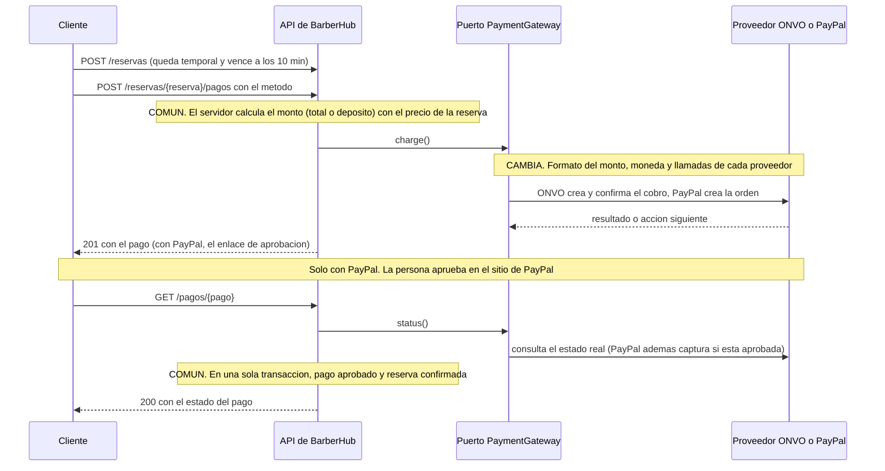

# BarberHub

Plataforma web multi-inquilino de reservas y cobro para barberías. Proyecto integrador del curso ISW-621 Programación en Ambiente Web II (UTN, Sede San Carlos).

## Estructura prevista

- `barberhub-api`: API REST en Laravel 13 y PHP 8.4, con PostgreSQL 18.
- `barberhub-web`: cliente web en Vue con TypeScript.

## Documentación: `context/`, `docs/` y `.claude/`

- **`context/`:** qué debe hacer el sistema (requisitos y reglas de negocio). Es la fuente de verdad funcional: los issues la citan por identificador (por ejemplo RF-10 o MT-03) y solo cambia por decisión del dueño del proyecto.
- **`docs/`:** cómo está construido el sistema (arquitectura, base de datos, modelo de datos, lenguaje ubicuo y decisiones). Evoluciona con el código y se completa en M02 (#21 a #26). Incluye el informe de la Investigación 1, `docs/investigacion-1.md`.
- **`.claude/`:** instrucciones y configuración del asistente de código.

**Mantenimiento:** si algo cambia, se corrige primero el archivo y después lo que dependa de él. Los identificadores no se reutilizan.

## Flujo de trabajo

- **Ramas:** una por issue, con el formato `<número>-<título-en-minúsculas-con-guiones>`. Ejemplo: `15-inicializar-el-repositorio-con-barberhub-api-barberhub-web-y-el-flujo-de-trabajo`.
- **Commits:** convencionales y en inglés, `<type>(<scope>): <description>`, con el pie `Refs: #n`. Ejemplo: `docs(readme): document the workflow` con el pie `Refs: #15`.
- **Pull requests:** uno por issue, con el título del issue y `Closes #n` en la descripción. Se integra con merge commit.
- **`main`:** está protegida; no admite cambios directos y exige pull request.

## Datos de demostración

`php artisan db:seed` (en `barberhub-api`) carga tres barberías ficticias, cada una con su dueño, su catálogo de servicios, su horario semanal y su personal con turnos, pausas y servicios habilitados. Es idempotente: se puede ejecutar varias veces y deja las mismas filas, sin duplicar nada. Todos los nombres, correos (dominio `.test`) y teléfonos son inventados (CL-08, RNF-23, RL-04). Los precios son enteros en colones con el IVA de 13 % incluido.

| Barbería | Enlace público | Pasarela | Dueño | Correo |
| --- | --- | --- | --- | --- |
| Barbería Pura Navaja | `pura-navaja` | ONVO Pay | Mauricio Solano | `mauricio@puranavaja.test` |
| Fade Lab | `fade-lab` | PayPal | Sofía Araya | `sofia@fadelab.test` |
| Barbería Don Chepe | `don-chepe` | Ninguna | José Alvarado | `chepe@donchepe.test` |

Todas las cuentas (dueños y colaboradores) usan la contraseña `Demo#Barber2026`, que cumple la política SE-07. Las cuentas de los colaboradores no piden cambiar la contraseña (`must_change_password` en falso), para usarlas sin trámites. Por ejemplo, `GET /api/v1/enlaces/pura-navaja` abre la primera barbería sin necesidad de ingresar.

### Barbería Pura Navaja

Horario: lunes a viernes de 9:00 a 19:00 y sábado de 8:00 a 17:00; domingo cerrado.

| Servicio | Duración | Precio (IVA incluido) |
| --- | --- | --- |
| Corte clásico | 30 min | ₡7 000 |
| Degradado | 45 min | ₡9 000 |
| Corte infantil | 30 min | ₡5 500 |
| Barba | 30 min | ₡5 000 |
| Corte + barba | 60 min | ₡12 500 |
| Perfilado de cejas | 15 min | ₡2 500 |
| Tratamiento capilar | 45 min | ₡10 000 |

| Colaborador | Correo | Turnos | Pausas | Sin el servicio |
| --- | --- | --- | --- | --- |
| Mauricio Solano (dueño, con perfil de colaborador) | `mauricio@puranavaja.test` | lunes a viernes 9:00-19:00; sábado 8:00-14:00 | martes 12:00-13:00 | Perfilado de cejas, Tratamiento capilar |
| Daniela Vargas | `daniela@puranavaja.test` | martes a viernes 10:00-19:00; sábado 8:00-17:00 | martes a viernes 13:00-14:00; sábado 12:00-12:30 | ninguno |
| Kevin Mora | `kevin@puranavaja.test` | lunes a viernes 9:00-17:00; sábado 9:00-15:00 | lunes a viernes 12:30-13:15; sábado 11:00-11:30 | Corte infantil |
| Esteban Quirós | `esteban@puranavaja.test` | lunes, miércoles y viernes 11:00-19:00; sábado 8:00-17:00 | lunes, miércoles y viernes 15:00-15:30; sábado 12:00-13:00 | Degradado, Corte + barba |

### Fade Lab

Horario: martes a sábado de 10:00 a 20:00 y domingo de 9:00 a 14:00; lunes cerrado.

| Servicio | Duración | Precio (IVA incluido) |
| --- | --- | --- |
| Degradado | 45 min | ₡11 000 |
| Corte de tijera | 40 min | ₡9 500 |
| Diseño de líneas | 20 min | ₡3 000 |
| Barba con toalla caliente | 30 min | ₡7 000 |
| Coloración | 90 min | ₡25 000 |
| Corte + degradado de barba | 60 min | ₡15 000 |

| Colaborador | Correo | Turnos | Pausas |
| --- | --- | --- | --- |
| Valeria Campos | `valeria@fadelab.test` | martes a sábado 10:00-20:00; domingo 9:00-14:00 | martes a sábado 14:00-15:00 |
| Andrés Rojas | `andres@fadelab.test` | miércoles a sábado 12:00-20:00; domingo 9:00-13:00 | miércoles a sábado 16:00-16:30 |

### Barbería Don Chepe

Horario: lunes a viernes de 7:00 a 17:00 y sábado de 7:00 a 12:00; domingo cerrado.

| Servicio | Duración | Precio (IVA incluido) |
| --- | --- | --- |
| Corte tradicional | 30 min | ₡4 500 |
| Corte para niño | 30 min | ₡3 500 |
| Afeitado clásico | 30 min | ₡4 000 |
| Corte + afeitado | 60 min | ₡7 500 |
| Cejas y orejas | 10 min | ₡1 500 |

| Colaborador | Correo | Turnos | Pausas |
| --- | --- | --- | --- |
| Ronny Vargas | `ronny@donchepe.test` | lunes a viernes 7:00-17:00; sábado 7:00-12:00 | lunes a viernes 11:30-12:30 |
| Luis Chaves | `luis@donchepe.test` | lunes a viernes 8:00-16:00 | lunes a viernes 12:00-12:45 |

> **Advertencia:** los datos de demostración son solo para desarrollo local. El sembrador se niega a ejecutarse en producción, porque sus cuentas comparten una contraseña conocida. Nunca se siembra en producción.

## Cobro con dos pasarelas

El sistema cobra una reserva, por el monto total o como depósito, con **ONVO Pay** y con **PayPal**, siempre en sus ambientes de pruebas: no se procesa dinero real. El resto del sistema no sabe cuál pasarela se usa. Los controladores trabajan con medios de pago genéricos (`tarjeta` y `sinpe_movil`) y cada proveedor vive detrás del puerto `PaymentGateway`, en su propio adaptador. La comparación de proveedores y la recomendación están en [`docs/investigacion-1.md`](docs/investigacion-1.md).

### Requisitos para probarlo

- Una cuenta de **ONVO Pay**, con sus llaves de prueba (`onvo_test_secret_key_…` y `onvo_test_publishable_key_…`), que se copian desde su panel.
- Una cuenta de **PayPal Developer**, con una aplicación *sandbox* (que entrega un *Client ID* y un *Secret*) y la cuenta compradora de pruebas de tipo *Personal*.
- PHP con certificados raíz. En Windows hay que descargar `https://curl.se/ca/cacert.pem` y apuntar a ese archivo con `curl.cainfo` y `openssl.cafile` en el `php.ini`; sin eso toda llamada HTTPS a un proveedor falla y la API responde 503.

### Variables de entorno

Se copia `.env.example` a `.env` y se completan los valores. El `.env` real no se versiona. Una llave `onvo_live_…` o la URL de producción de PayPal se rechazan al construir el adaptador.

| Variable | Para qué sirve |
| --- | --- |
| `PAYMENTS_DEFAULT_GATEWAY` | Pasarela por defecto (`onvo` o `paypal`) para barberías que no eligieron una. |
| `ONVO_SECRET_KEY` | Llave secreta de pruebas de ONVO. |
| `ONVO_BASE_URL` | URL base de la API. Por defecto `https://api.onvopay.com/v1`. |
| `ONVO_RETURN_URL` | Dirección de retorno tras una autenticación 3DS. |
| `ONVO_SINPE_DESTINATION` | Número SINPE Móvil de ONVO al que se transfiere. Por defecto `+506 70196686`. |
| `PAYPAL_CLIENT_ID` y `PAYPAL_CLIENT_SECRET` | Credenciales de la aplicación *sandbox*. |
| `PAYPAL_BASE_URL` | URL base de la API. Por defecto `https://api-m.sandbox.paypal.com`. |
| `PAYPAL_RETURN_URL` y `PAYPAL_CANCEL_URL` | Adónde vuelve la persona tras aprobar o cancelar. Por ejemplo, `http://127.0.0.1:8000/api/v1/pagos/retorno`. |
| `PAYPAL_CRC_PER_USD` | Tipo de cambio (colones por dólar) con el que PayPal cobra en USD. Por defecto 500. |

La llave pública de ONVO (`onvo_test_publishable_key_…`) no es una variable de la API: el servidor nunca la lee. La usa quien crea el método de pago de la tarjeta (el navegador, o Postman).

### Cambiar de pasarela

Cada barbería tiene su pasarela. El dueño la cambia con una petición, sin tocar código:

```http
PATCH /api/v1/barberias/{barberia}/administracion/cobro
{ "pasarela": "paypal" }
```

El valor es `onvo` o `paypal`. La política de cobro vive en el mismo recurso: `modalidad` (`sin_pago`, `deposito` o `total`), `porcentaje_deposito` y `plazo_cancelacion_horas`. Con los datos de demostración, Pura Navaja cobra un depósito del 30 % con ONVO y Fade Lab cobra el total con PayPal. Cambiar la pasarela no afecta a un cobro que ya se inició.

### Flujo de cobro



Lo que es común a las dos pasarelas:

- **Monto:** lo calcula siempre el servidor con el precio de la reserva. Un campo `monto` enviado por el cliente se ignora.
- **Estado:** nunca se confía en el navegador, siempre se consulta al proveedor. Esta entrega no usa webhooks.
- **Idempotencia:** hay un solo pago activo por reserva, así que pulsar «pagar» dos veces devuelve el mismo pago.
- **Medios de pago:** cada pasarela declara los que admite. Pedir `sinpe_movil` con PayPal responde 422 sin romper nada.
- **Tres desenlaces:** aprobado, rechazado y error de comunicación. En el último, el pago queda `failed` o `pending` y la reserva no se pierde.

Lo que cambia por proveedor:

- **Monto y moneda:** ONVO recibe la unidad mínima de la moneda (₡5.000 se envía como `500000`). PayPal recibe un texto decimal en dólares (`"10.00"`). La conversión vive dentro de cada adaptador.
- **Reembolso:** está implementado en ONVO (`POST /api/v1/barberias/{barberia}/pagos/{pago}/reembolsos`, solo el dueño). En PayPal no se implementó: el mismo endpoint responde 409 `conflicto` y no llama a PayPal. Se haría con `POST /v2/payments/captures/{captura}/refund`, y se omitió porque el enunciado solo pide documentarlo.

### Ejecutar el flujo

Con la API en marcha (`php artisan serve`, dentro de `barberhub-api`), los datos de demostración sembrados y la barbería configurada con la pasarela que se quiere probar. Cada reserva con cobro vence a los 10 minutos, así que conviene crearla justo antes de pagar. Las colecciones de Postman de `docs/postman/` ejecutan estos pasos; en su entorno hay que agregar `onvo_publishable_key` solo en *Current value*.

**ONVO, tarjeta.** El número de la tarjeta nunca pasa por nuestro servidor:

1. Se reserva un espacio, que queda temporal.
2. Se crea el método de pago directamente en ONVO con la llave pública: `POST https://api.onvopay.com/v1/payment-methods`, con `Authorization: Bearer <llave pública de ONVO>` y el cuerpo `{"type":"card","card":{"number":"4242424242424242","expMonth":12,"expYear":2030,"cvv":"123","holderName":"Cliente Prueba"},"billing":{"name":"Cliente Prueba","email":"cliente@example.com","address":{"country":"CR"}}}`. La respuesta trae un `id`.
3. Se paga con `POST /api/v1/barberias/{barberia}/reservas/{reserva}/pagos` y el cuerpo `{"metodo":"tarjeta","token":"<id del paso 2>"}`.
4. Se consulta el resultado con `GET /api/v1/barberias/{barberia}/pagos/{pago}`: la reserva queda confirmada.

**ONVO, SINPE Móvil.** Se paga con el cuerpo `{"metodo":"sinpe_movil","telefono":"+50688888888","identificacion":"01-1393-1919","tipo_identificacion":"0"}`. El pago queda pendiente, con las instrucciones de la transferencia. A los 15 segundos, el número de prueba «transfiere» y la consulta del estado devuelve el pago aprobado.

**PayPal, tarjeta.** Se paga con el cuerpo `{"metodo":"tarjeta"}` y la respuesta trae el enlace de aprobación. Se abre en el navegador, se inicia sesión con la cuenta compradora de pruebas y se aprueba. Al consultar el estado, el servidor captura el cobro y la reserva queda confirmada.

Datos de prueba de ONVO, tomados de [su documentación](https://docs.onvopay.com/en/payments/testing):

| Caso | Dato |
| --- | --- |
| Tarjeta aprobada | `4242 4242 4242 4242` |
| Tarjeta rechazada | `4000 0000 0000 0002` |
| Error del procesador | `4000 0000 0000 0119` |
| SINPE Móvil aprobado | `+50688888888`, con identificación `01-1393-1919` (tipo `0`). Pasa a aprobado a los 15 segundos |
| SINPE Móvil sin transferencia | `+50688889521`. Queda pendiente indefinidamente |

### Pruebas automatizadas

`composer test` cubre los tres desenlaces en las dos pasarelas con `Http::fake()` y `Http::preventStrayRequests()`, de modo que ninguna prueba puede llamar a un proveedor real. Se ejecutan, junto con Pint y Larastan, en la integración continua de cada pull request.

### Alcance

Esta entrega no incluye webhooks (se migra a ellos en el Avance 2), pagos en producción ni dinero real, suscripciones, pagos divididos ni factura electrónica. Tilopay y GreenPay solo se analizan en el informe, sin integrarlos.

## Integración continua

El flujo `.github/workflows/ci.yml` se ejecuta en cada pull request y en cada push a `main`. Cancela las ejecuciones obsoletas de la misma rama y corre cuatro trabajos independientes y en paralelo:

| Trabajo | Qué verifica |
| --- | --- |
| `lint` | `composer validate --strict` y Pint (`composer lint`). |
| `analyse` | Larastan (`composer analyse`). |
| `test` | Levanta PostgreSQL 18, crea los roles y las bases con `database/roles.sql` y ejecuta `php artisan test` (suites `Unit`, `Architecture` y `Feature`, incluidas las pruebas de concurrencia). |
| `secrets` | gitleaks sobre todo el historial; falla si encuentra una credencial. |

Las contraseñas del trabajo `test` son valores inventados para la base efímera de cada ejecución; no son secretos reales. gitleaks se descarga en una versión fija y se verifica con su suma SHA-256. Si algún día marca un valor ficticio a propósito, se agrega una excepción mínima, por archivo y por valor, en un `.gitleaks.toml`, con un comentario que explique por qué es ficticio; nunca se excluyen carpetas ni reglas enteras.

### Bloquear la integración con la CI en rojo

Que un pull request con la CI en rojo no se pueda integrar es una regla de GitHub, no código. Pasos (requieren permisos de administrador del repositorio):

1. Abre el repositorio en GitHub y ve a **Settings > Rules > Rulesets**.
2. Abre la regla que protege `main` (o crea una con **New ruleset > New branch ruleset** y como destino la rama `main`), con **Enforcement status** en **Active**.
3. Activa **Require status checks to pass**.
4. Con **Add checks**, agrega los cuatro trabajos: `lint`, `analyse`, `test` y `secrets`. Si no aparecen en la lista, primero debe haberse ejecutado el flujo al menos una vez en un pull request.
5. Opcional: activa **Require branches to be up to date before merging**.
6. Guarda con **Create** o **Save changes**.

Cómo comprobar que funciona:

1. Crea una rama de prueba con un error evidente, por ejemplo un archivo PHP con una línea mal indentada, y abre un pull request hacia `main`.
2. Espera a que el trabajo `lint` termine en rojo.
3. Comprueba que el botón **Merge pull request** está desactivado y que la sección de verificaciones dice que faltan los checks requeridos.
4. Corrige el error y haz push: cuando los cuatro trabajos queden en verde, el botón se activa.
5. Cierra el pull request de prueba y borra la rama.

## Estado

En construcción. La instalación y la declaración de uso de IA se documentan a medida que avanza el proyecto.