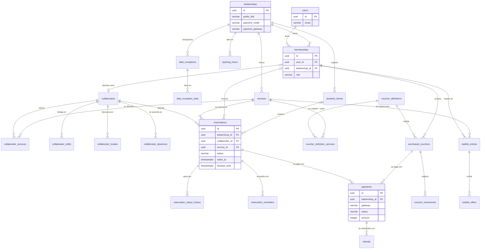

# Modelo de datos

El esquema está en tercera forma normal. Este documento describe las entidades de BarberHub, sus relaciones y sus restricciones; cada módulo ajusta las suyas en el pull request que agrega su migración (regla del final).

Las convenciones de nombres, llaves, fechas y dinero están en [database.md](database.md). Toda tabla con `barbershop_id` tiene seguridad a nivel de fila forzada, con las excepciones que lista la sección de ese documento.

> **Estado:** modelo inicial (issue #26), derivado de las reglas de negocio y de los requisitos. Las tablas `users` (#40), `barbershops` y `memberships` (#36) ya existen; las demás todavía no: cada una la crea el issue de su módulo (#45, #47, #48 y #56, entre otros) y en ese pull request se actualiza este archivo. Es una propuesta para revisar; las decisiones que no están en los requisitos están marcadas en "Por confirmar".

## Diagrama

El diagrama omite `invitations`, `personal_access_tokens`, `webhook_events` y `audit_log` para mantenerse legible; sus columnas están más abajo.

## Cuentas y acceso

### users

Cada fila es una cuenta global: una persona puede tener un rol distinto en cada barbería. La tabla existe desde el issue #40 con las columnas marcadas como creadas; las demás son previstas y las agrega el issue que se indica, con una migración posterior.

| Columna | Tipo | Regla |
| --- | --- | --- |
| `id` | `uuid` | Llave primaria, `DEFAULT uuidv7()` |
| `name` | `varchar(120)` | Obligatoria |
| `email` | `varchar(255)` | Única en todo el sistema; se guarda recortada y en minúsculas (CL-01) |
| `password` | `varchar(255)` | Hash de la contraseña, nunca la contraseña (SE-01) |
| `phone` | `varchar(30)` | Admite nulos en la base; el registro la exige (RF-38) |
| `locale` | `varchar(5)` | Prevista, #47. `CHECK` entre `es` y `en`, por defecto `es` (AC-08) |
| `reminders_enabled` | `boolean` | Prevista, #47. Por defecto `true`; solo tiene efecto para el cliente (NO-10) |
| `must_change_password` | `boolean` | Prevista, #48. Por defecto `false`; `true` con una contraseña temporal (UP-04, RF-40) |
| `is_active` | `boolean` | Por defecto `true`; una cuenta inactiva no puede ingresar |
| `terms_accepted_at`, `privacy_accepted_at` | `timestamptz` | Fecha de cada aceptación, separadas (CL-02). Admiten nulos en la base: la cuenta de un colaborador la crea el dueño y su caso se decide en el #48; el registro de clientes las exige y las guarda |
| `created_at`, `updated_at` | `timestamptz` | Por defecto `now()` |

El correo es único en todo el sistema y no dentro de cada barbería: la persona ingresa con su correo antes de saber a qué barbería va. Por eso `users` no tiene política de fila. Los intentos fallidos de ingreso (SE-05) se limitan con el limitador de Laravel, no con columnas.

### memberships

El rol de una persona en una barbería (UP-01). Es la fuente de verdad de quién puede entrar a qué. La tabla existe desde el issue #36 con todas las columnas de abajo. Todavía no tiene política de fila: llega con el #38.

| Columna | Tipo | Regla |
| --- | --- | --- |
| `id` | `uuid` | Llave primaria |
| `user_id` | `uuid` | Llave foránea a `users`, borrado en cascada |
| `barbershop_id` | `uuid` | Llave foránea a `barbershops`, borrado en cascada |
| `role` | `varchar(20)` | `CHECK` entre `owner`, `collaborator` y `customer` |
| `is_active` | `boolean` | Por defecto `true` |
| `created_at`, `updated_at` | `timestamptz` | Por defecto `now()` |

Llaves candidatas: `id`, `(user_id, barbershop_id)` y `(id, barbershop_id)`. La segunda garantiza un único rol por persona y barbería (UP-07); la tercera permite que otras tablas referencien la membresía junto con su barbería. Una barbería siempre conserva al menos un dueño activo (UP-05): lo verifica el caso de uso.

### invitations (complementaria, RF-06)

| Columna | Tipo | Regla |
| --- | --- | --- |
| `id`, `barbershop_id` | `uuid` | Llave primaria y llave foránea a `barbershops` |
| `email` | `varchar(255)` | Correo invitado |
| `token_hash` | `varchar(64)` | Única; hash del token, nunca el token |
| `expires_at` | `timestamptz` | Siete días desde el envío (UP-04) |
| `used_at` | `timestamptz` | Nula hasta que se usa; de un solo uso |
| `invited_by_membership_id` | `uuid` | Quién la creó |

### personal_access_tokens y password_reset_tokens

Las crean Laravel y Sanctum. `personal_access_tokens` (migración del #41) guarda un token por dispositivo (`token` es el hash SHA-256; `tokenable_id` es un UUID, y `abilities` queda con el valor por defecto porque el rol no viaja en el token). `password_reset_tokens` guarda el hash del enlace de restablecimiento, que caduca a los 60 minutos y se borra al usarse (SE-06).

## Barbería y configuración

### barbershops

Cada fila es un inquilino. La política de cobro y la pasarela son parámetros de cada barbería (MT-04), por eso viven aquí. La tabla existe desde el issue #36 y el #37 le agregó `public_link`; las columnas marcadas como previstas y las agrega el issue que se indica, con una migración posterior. Todavía no tiene política de fila: llega con el #38.

| Columna | Tipo | Regla |
| --- | --- | --- |
| `id` | `uuid` | Llave primaria, `DEFAULT uuidv7()` |
| `name` | `varchar(120)` | Obligatoria |
| `city` | `varchar(80)` | Obligatoria (RF-01) |
| `phone` | `varchar(30)` | Obligatorio; es el contacto de la barbería (RF-01) |
| `public_link` | `varchar(120)` | Obligatoria, creada en el #37. Llave única `barbershops_public_link_unique` en todo el sistema y `CHECK` `barbershops_public_link_format_check` (minúsculas, dígitos y guiones). Se deriva del nombre al registrar la barbería, con un número si ya existe, y no cambia al renombrarla (RF-02, MT-07) |
| `logo_path` | `varchar(255)` | Prevista, #46. Opcional; guardado y servido por barbería (MT-05) |
| `payment_mode` | `varchar(10)` | Prevista, #49. `CHECK` entre `none`, `deposit` y `full` (PA-01) |
| `deposit_percentage` | `smallint` | Prevista, #49. `CHECK` entre 10 y 100; obligatoria si `payment_mode` es `deposit` |
| `cancellation_deadline_hours` | `smallint` | Prevista, #49. `CHECK` mayor o igual que 0 (CA-01) |
| `payment_gateway` | `varchar(10)` | Prevista, #49. `CHECK` entre `onvo` y `paypal` (PA-02) |
| `vouchers_enabled`, `waitlist_enabled` | `boolean` | Prevista, #49. Por defecto `false` (RF-09) |
| `created_at`, `updated_at` | `timestamptz` | Por defecto `now()` |

Las credenciales de las pasarelas no se guardan aquí: viven en variables de entorno. Si cada barbería necesita su propia cuenta de cobro, queda por definir en PD-07.

### services

| Columna | Tipo | Regla |
| --- | --- | --- |
| `id` | `uuid` | Llave primaria |
| `barbershop_id` | `uuid` | Llave foránea a `barbershops`, borrado en cascada |
| `name` | `varchar(120)` | Obligatoria |
| `duration_minutes` | `smallint` | `CHECK` entre 10 y 180 y múltiplo de 5 (SV-01) |
| `price` | `integer` | Colones enteros con IVA incluido, `CHECK` mayor que 0 (SV-01, SV-02) |
| `image_path` | `varchar(255)` | Opcional; JPG, PNG o WebP de hasta 2 MB (SV-06) |
| `is_active` | `boolean` | Por defecto `true` (SV-04) |
| `created_at`, `updated_at` | `timestamptz` | |

Llaves candidatas: `id` y `(id, barbershop_id)`.

### opening_hours, date_exceptions y date_exception_slots

El horario semanal de la barbería y sus excepciones por fecha (HO-01).

| Tabla | Columnas | Regla |
| --- | --- | --- |
| `opening_hours` | `id`, `barbershop_id`, `day_of_week`, `opens_at`, `closes_at` | `day_of_week` entre 1 (lunes) y 7 (domingo); `CHECK (opens_at < closes_at)`; `opening_hours_no_overlap_excl` impide franjas traslapadas el mismo día |
| `date_exceptions` | `id`, `barbershop_id`, `on_date`, `is_closed`, `reason` | Única `(barbershop_id, on_date)`; un día cerrado o un día con horario especial |
| `date_exception_slots` | `id`, `barbershop_id`, `date_exception_id`, `opens_at`, `closes_at` | Solo para excepciones con `is_closed = false`; mismas reglas de traslape; llave foránea `(date_exception_id, barbershop_id)` |

Sin una excepción para la fecha, rige el horario semanal; con una, esta lo reemplaza. Las horas no llevan zona horaria: son horas de pared de la barbería, que opera en `America/Costa_Rica` (HO-03).

### collaborators

El perfil con agenda: la persona que atiende. Un dueño que corta (CO-02) tiene su membresía de `owner` y además un perfil aquí.

| Columna | Tipo | Regla |
| --- | --- | --- |
| `id` | `uuid` | Llave primaria |
| `barbershop_id` | `uuid` | Llave foránea a `barbershops` |
| `membership_id` | `uuid` | Llave foránea compuesta `(membership_id, barbershop_id)` a `memberships`; única |
| `is_active` | `boolean` | Por defecto `true`; no se desactiva con reservas futuras confirmadas (CO-03) |
| `created_at`, `updated_at` | `timestamptz` | `created_at` es la antigüedad de alta que desempata «cualquiera disponible» (DI-04) |

### collaborator_services, collaborator_shifts, collaborator_breaks y collaborator_absences

| Tabla | Columnas | Regla |
| --- | --- | --- |
| `collaborator_services` | `barbershop_id`, `collaborator_id`, `service_id` | Llave primaria `(collaborator_id, service_id)`; llaves foráneas compuestas con `barbershop_id`; define los servicios habilitados (CO-01) |
| `collaborator_shifts` | `id`, `barbershop_id`, `collaborator_id`, `day_of_week`, `starts_at`, `ends_at` | Franjas de trabajo por día; sin traslape (`EXCLUDE`); deben caer dentro del horario de la barbería (HO-02), lo que verifica el caso de uso |
| `collaborator_breaks` | `id`, `barbershop_id`, `collaborator_id`, `day_of_week`, `starts_at`, `ends_at` | Pausas por día; sin traslape |
| `collaborator_absences` | `id`, `barbershop_id`, `collaborator_id`, `starts_at`, `ends_at`, `reason` | Instantes con `timestamptz`; `CHECK (starts_at < ends_at)`; complementaria (RF-07, CO-06) |

## Reservas

### assisted_clients

La persona que el dueño registra para una reserva asistida, sin cuenta (CL-06). Existe solo dentro de su barbería.

| Columna | Tipo | Regla |
| --- | --- | --- |
| `id`, `barbershop_id` | `uuid` | Llave primaria y llave foránea a `barbershops` |
| `name` | `varchar(120)` | Obligatoria |
| `phone` | `varchar(30)` | Obligatoria |
| `email` | `varchar(255)` | Opcional; sin correo no recibe recordatorios |
| `created_at`, `updated_at` | `timestamptz` | |

### reservations

El espacio de un colaborador asignado a un cliente para un servicio (RE-03). Es el agregado más importante.

| Columna | Tipo | Regla |
| --- | --- | --- |
| `id` | `uuid` | Llave primaria |
| `barbershop_id` | `uuid` | Llave foránea a `barbershops` |
| `collaborator_id`, `service_id` | `uuid` | Llaves foráneas compuestas con `barbershop_id` |
| `customer_membership_id` | `uuid` | Opcional; llave foránea compuesta a `memberships` |
| `assisted_client_id` | `uuid` | Opcional; llave foránea compuesta a `assisted_clients` |
| `created_by_membership_id` | `uuid` | Opcional; quien la creó cuando es asistida |
| `purchased_voucher_id` | `uuid` | Opcional; el bono usado (RF-28) |
| `status` | `varchar(30)` | `CHECK` entre los siete estados de RE-04 |
| `starts_at`, `ends_at` | `timestamptz` | Inicio y fin del servicio; `CHECK (starts_at < ends_at)` |
| `blocked_until` | `timestamptz` | Fin del servicio más 5 minutos de limpieza; `CHECK (ends_at <= blocked_until)` |
| `price` | `integer` | Precio vigente al reservar (SV-03) |
| `duration_minutes` | `smallint` | Duración vigente al reservar (SV-03) |
| `cancellation_deadline_hours` | `smallint` | Plazo de cancelación vigente al reservar (CA-01) |
| `deposit_amount` | `integer` | `CHECK` mayor o igual que 0; depósito calculado al reservar (PA-06) |
| `expires_at` | `timestamptz` | Solo en las temporales: 10 minutos desde que inicia el pago (RE-05) |
| `reschedule_count` | `smallint` | `CHECK` entre 0 y 2 (CA-05) |
| `created_at`, `updated_at` | `timestamptz` | |

Restricciones:

- `CHECK (num_nonnulls(customer_membership_id, assisted_client_id) = 1)`: la reserva es de una cuenta o de un cliente asistido, nunca de ambos.
- `reservations_no_overlap_excl`: un colaborador no tiene dos reservas temporales o confirmadas con intervalos solapados, incluida la limpieza (RE-01). Ver [database.md](database.md).
- Una segunda exclusión sobre `(barbershop_id, customer_membership_id, tstzrange(starts_at, ends_at))`, solo para estado `confirmed`: un cliente no tiene dos reservas confirmadas solapadas en la barbería (RE-06).

El saldo pendiente por cobrar en el local (PA-10) es `price - deposit_amount` y no se guarda.

### reservation_status_history

Cada cambio de estado, con fecha y autor (RE-09).

| Columna | Tipo | Regla |
| --- | --- | --- |
| `id`, `barbershop_id`, `reservation_id` | `uuid` | Llave primaria y llaves foráneas compuestas |
| `from_status` | `varchar(30)` | Nula en el estado inicial |
| `to_status` | `varchar(30)` | `CHECK` entre los siete estados |
| `changed_by_membership_id` | `uuid` | Nula cuando cambia el sistema (webhook, expiración) |
| `changed_at` | `timestamptz` | |

### reservation_reminders

Evita que un recordatorio se envíe dos veces (NO-03).

| Columna | Tipo | Regla |
| --- | --- | --- |
| `id`, `barbershop_id`, `reservation_id` | `uuid` | Llave primaria y llaves foráneas compuestas |
| `kind` | `varchar(3)` | `CHECK` entre `24h` y `2h` (NO-02) |
| `scheduled_for` | `timestamptz` | Momento en que debe enviarse |
| `sent_at` | `timestamptz` | Nula hasta que se envía |

Llave candidata: `(reservation_id, kind)`.

## Pagos

### payments

Un pago es de una reserva o de la compra de un bono, nunca de ambos.

| Columna | Tipo | Regla |
| --- | --- | --- |
| `id`, `barbershop_id` | `uuid` | Llave primaria y llave foránea a `barbershops` |
| `reservation_id` | `uuid` | Opcional; llave foránea compuesta a `reservations` |
| `purchased_voucher_id` | `uuid` | Opcional; llave foránea compuesta a `purchased_vouchers` |
| `gateway` | `varchar(10)` | `CHECK` entre `onvo` y `paypal`; la pasarela vigente al cobrar (PA-02) |
| `gateway_reference` | `varchar(255)` | Identificador del cobro en la pasarela |
| `amount` | `integer` | Colones enteros, `CHECK` mayor que 0 |
| `status` | `varchar(10)` | `CHECK` entre `pending`, `confirmed` y `failed`; solo lo fija el webhook verificado (PA-03) |
| `confirmed_at` | `timestamptz` | |
| `created_at`, `updated_at` | `timestamptz` | |

`CHECK (num_nonnulls(reservation_id, purchased_voucher_id) = 1)`. Llave candidata: `(gateway, gateway_reference)`.

### refunds (complementaria, RF-24)

El «depósito a devolver» de CA-02 es un reembolso en estado `due`.

| Columna | Tipo | Regla |
| --- | --- | --- |
| `id`, `barbershop_id`, `payment_id` | `uuid` | Llave primaria y llaves foráneas compuestas |
| `amount` | `integer` | `CHECK` mayor que 0 |
| `reason` | `varchar(30)` | `CHECK` entre `cancelled_in_time`, `cancelled_by_barbershop` y `late_confirmation` |
| `status` | `varchar(10)` | `CHECK` entre `due`, `pending`, `completed` y `failed` (PA-08) |
| `gateway_reference` | `varchar(255)` | Opcional |
| `completed_at`, `created_at`, `updated_at` | `timestamptz` | |

### webhook_events

El aviso de la pasarela se procesa una sola vez (PA-05).

| Columna | Tipo | Regla |
| --- | --- | --- |
| `id` | `uuid` | Llave primaria |
| `gateway` | `varchar(10)` | `CHECK` entre `onvo` y `paypal` |
| `event_id` | `varchar(255)` | Identificador del evento en la pasarela |
| `event_type` | `varchar(100)` | |
| `payment_id` | `uuid` | Nula hasta que el evento se asocia a un pago |
| `received_at`, `processed_at` | `timestamptz` | `processed_at` nula hasta procesarse |

Llave candidata: `(gateway, event_id)`. No lleva `barbershop_id`: llega antes de saber a qué barbería pertenece (ver "Pendientes" en [database.md](database.md)).

## Bonos

### voucher_definitions y voucher_definition_services

El bono que la barbería vende (BO-01) y los servicios que cubre.

| Tabla | Columnas | Regla |
| --- | --- | --- |
| `voucher_definitions` | `id`, `barbershop_id`, `name`, `sessions_count`, `price`, `validity_days`, `is_active` | `sessions_count`, `price` y `validity_days` mayores que 0; `is_active = false` lo retira de la venta (RF-26) |
| `voucher_definition_services` | `barbershop_id`, `voucher_definition_id`, `service_id` | Llave primaria `(voucher_definition_id, service_id)`; llaves foráneas compuestas |

### purchased_vouchers

El bono adquirido por un cliente: un agregado con su saldo en sesiones.

| Columna | Tipo | Regla |
| --- | --- | --- |
| `id`, `barbershop_id` | `uuid` | Llave primaria y llave foránea a `barbershops` |
| `customer_membership_id` | `uuid` | Llave foránea compuesta a `memberships` |
| `voucher_definition_id` | `uuid` | Llave foránea compuesta a `voucher_definitions` |
| `name`, `price`, `sessions_count` | `varchar`, `integer`, `smallint` | Copiados de la definición al comprar |
| `status` | `varchar(10)` | `CHECK` entre `pending` y `active`; pasa a `active` solo cuando el webhook confirma el pago (BO-02) |
| `activated_at`, `expires_at` | `timestamptz` | Nulas hasta la activación; `expires_at` es `activated_at` más la vigencia |
| `remaining_sessions` | `smallint` | `CHECK (remaining_sessions >= 0)` (BO-03) |
| `created_at`, `updated_at` | `timestamptz` | |

Un bono vencido no cambia de estado: la vigencia se valida al reservar y al consultar el saldo (BO-07).

### voucher_movements

El registro de cada movimiento de saldo, ligado a su reserva (BO-09).

| Columna | Tipo | Regla |
| --- | --- | --- |
| `id`, `barbershop_id`, `purchased_voucher_id` | `uuid` | Llave primaria y llaves foráneas compuestas |
| `reservation_id` | `uuid` | Opcional; la reserva que lo originó |
| `type` | `varchar(10)` | `CHECK` entre `purchase`, `hold`, `consume` y `release` |
| `sessions_delta` | `smallint` | `purchase` suma sesiones, `hold` resta una, `release` devuelve una y `consume` confirma el uso con 0 |
| `created_at` | `timestamptz` | |

## Lista de espera

### waitlist_entries

La fila de un cliente para un servicio y un día (LE-01).

| Columna | Tipo | Regla |
| --- | --- | --- |
| `id`, `barbershop_id` | `uuid` | Llave primaria y llave foránea a `barbershops` |
| `customer_membership_id`, `service_id` | `uuid` | Llaves foráneas compuestas |
| `collaborator_id` | `uuid` | Nulo significa «cualquiera»; llave foránea compuesta |
| `desired_date` | `date` | Día buscado |
| `status` | `varchar(10)` | `CHECK` entre `waiting`, `offered`, `fulfilled` y `left` |
| `joined_at` | `timestamptz` | Ordena la fila: primero en entrar, primero en recibir oferta (LE-02) |
| `created_at`, `updated_at` | `timestamptz` | |

El máximo de 3 filas activas por cliente (LE-01) lo verifica el caso de uso.

### waitlist_offers

El espacio liberado que se propone a la primera persona compatible (LE-03, LE-04).

| Columna | Tipo | Regla |
| --- | --- | --- |
| `id`, `barbershop_id`, `waitlist_entry_id` | `uuid` | Llave primaria y llaves foráneas compuestas |
| `collaborator_id` | `uuid` | Llave foránea compuesta |
| `starts_at`, `ends_at` | `timestamptz` | El espacio ofrecido |
| `expires_at` | `timestamptz` | 15 minutos desde la creación (LE-04) |
| `status` | `varchar(10)` | `CHECK` entre `pending`, `accepted`, `rejected` y `expired` |
| `responded_at`, `created_at` | `timestamptz` | |

Mientras una oferta está `pending`, su espacio no aparece disponible para otras personas (DI-05). Como esa regla cruza dos tablas (`reservations` y `waitlist_offers`), no cabe en una restricción `EXCLUDE`: la garantiza el caso de uso, bajo el mismo bloqueo del colaborador que usa la reserva.

## Registro técnico

### audit_log

Acciones sensibles con autor, fecha y cambio, sin pantalla de consulta (SE-04).

| Columna | Tipo | Regla |
| --- | --- | --- |
| `id`, `barbershop_id` | `uuid` | Llave primaria y llave foránea a `barbershops` |
| `actor_user_id` | `uuid` | Quién actuó |
| `action` | `varchar(60)` | Por ejemplo `reservation.cancelled_by_barbershop` |
| `subject_type`, `subject_id` | `varchar(60)`, `uuid` | Sobre qué |
| `changes` | `jsonb` | Valores anteriores y nuevos; nunca contraseñas ni tokens |
| `created_at` | `timestamptz` | |

## Tablas de infraestructura de Laravel

Laravel y Sanctum aportan sus propias tablas. Ya existen `personal_access_tokens` (#41), `cache` y `cache_locks` (#41, con el driver de caché `database`, que guarda los contadores de intentos de ingreso); `jobs` y `failed_jobs` se agregan cuando se elija el driver de colas (PD-03). No pertenecen a una barbería y no tienen política de fila.

## Verificación de las formas normales

| Forma | Qué exige | Cómo se cumple |
| --- | --- | --- |
| Primera | Valores atómicos, sin grupos repetidos | Una fila por franja, pausa o servicio habilitado; los servicios que cubre un bono son una tabla, no una lista en el bono |
| Segunda | Ningún dato depende de una parte de la llave | Las llaves primarias son de una sola columna (`id`), salvo las tablas de unión, que no tienen más datos que la llave |
| Tercera | Ningún dato depende de otro que no sea llave | El nombre y el precio del servicio viven en `services`; el saldo pendiente y «bono vencido» no se guardan, se calculan |

## Excepciones deliberadas

| Excepción | Por qué es correcta |
| --- | --- |
| `barbershop_id` se repite en toda tabla hija aunque el padre ya lo implica | El aislamiento no depende del código. Las llaves foráneas compuestas `(x_id, barbershop_id)` impiden que los dos valores discrepen |
| La reserva guarda `price`, `duration_minutes`, `cancellation_deadline_hours` y `deposit_amount` | No son datos derivados: son el hecho de a cuánto, por cuánto tiempo y con qué plazo se reservó. Cambiar el catálogo o las políticas no debe alterar reservas existentes (SV-03, CA-01) |
| `reservations.blocked_until` es `ends_at` más 5 minutos | Una expresión de índice debe ser inmutable y sumar un intervalo a un `timestamptz` no lo es; guardarlo permite la restricción `EXCLUDE` que impide el solape |
| `purchased_vouchers.remaining_sessions` se puede calcular desde `voucher_movements` | Se mantiene para decrementarlo de forma atómica y condicional, con `CHECK (>= 0)`, sin leer el registro completo (BO-03). Una prueba verifica que ambos coincidan |
| `purchased_vouchers` copia `name`, `price` y `sessions_count` de la definición | Es lo que se compró: editar o retirar la definición no cambia el bono adquirido ni el reporte de ingresos |
| `personal_access_tokens.id` es `bigint` y no `uuid` | La tabla pertenece a Sanctum: el token que recibe el cliente tiene la forma `<id>\|<secreto>` y Sanctum busca la fila por ese número |
| `personal_access_tokens` no tiene llave foránea a `users` | Sanctum define una relación polimórfica; un token cuya cuenta ya no existe no autentica a nadie |

## Por confirmar

1. **Excepciones por fecha (RF-04).** Se modelaron como `date_exceptions` con `date_exception_slots` para poder abrir un feriado con horario especial. Si el dueño solo necesita cerrar días, basta una tabla de cierres.
2. **Aceptaciones de los colaboradores.** CL-02 exige las dos aceptaciones para crear una cuenta. Una cuenta de colaborador que crea el dueño (UP-04) todavía no las tiene: ¿se piden en su primer ingreso?
3. **Servicios cubiertos por un bono adquirido.** Se leen de la definición viva. Si el dueño edita los servicios de un bono ya vendido, cambia lo que cubre el que ya compraron los clientes. ¿Se congelan al comprar?
4. **Nombre de servicio único por barbería.** Los requisitos no lo exigen, así que no hay restricción.
5. **`memberships` sin política de fila** y **búsqueda del pago por webhook sin barbería en curso.** Ver "Pendientes" en [database.md](database.md).
6. **Corte infantil.** CL-05 pide registrarlo a nombre de una persona adulta responsable, y no hay un campo que lo distinga de otro servicio.

## Regla para cada migración nueva

Antes de fusionar un pull request con una migración se revisa que la tabla tenga llave primaria `id`, que lleve `barbershop_id` si pertenece a una barbería, que sus llaves únicas y foráneas incluyan `barbershop_id`, que tenga la seguridad a nivel de fila habilitada y forzada con su política `<tabla>_barbershop_isolation` (o que su excepción esté justificada en [database.md](database.md)), que no guarde valores calculables y que este documento quede actualizado.
