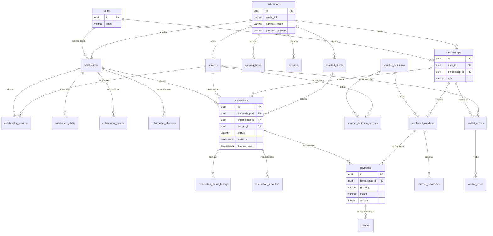

# Modelo de datos

El esquema está en tercera forma normal. Este documento describe las entidades de BarberHub, sus relaciones y sus restricciones; cada módulo ajusta las suyas en el pull request que agrega su migración (regla del final).

Las convenciones de nombres, llaves, fechas y dinero están en [database.md](database.md). Toda tabla con `barbershop_id` tiene seguridad a nivel de fila forzada, con las excepciones que lista la sección de ese documento.

> **Estado:** modelo inicial (issue #26), derivado de las reglas de negocio y de los requisitos. Las tablas `users` (#40), `barbershops` y `memberships` (#36), `services` (#45), `opening_hours` y `closures` (#47) ya existen; las demás todavía no: cada una la crea el issue de su módulo (#48 y #56, entre otros) y en ese pull request se actualiza este archivo. Es una propuesta para revisar; las decisiones que no están en los requisitos están marcadas en "Por confirmar".

## Diagrama

El diagrama omite `invitations`, `personal_access_tokens`, `webhook_events` y `audit_log` para mantenerse legible; sus columnas están más abajo.

## Cuentas y acceso

### users

Cada fila es una cuenta global: una persona puede tener un rol distinto en cada barbería. La tabla existe desde el issue #40 con las columnas marcadas como creadas; las demás son previstas y las agrega el issue que se indica, con una migración posterior (`must_change_password` llegó con el #48).

| Columna | Tipo | Regla |
| --- | --- | --- |
| `id` | `uuid` | Llave primaria, `DEFAULT uuidv7()` |
| `name` | `varchar(120)` | Obligatoria |
| `email` | `varchar(255)` | Única en todo el sistema; se guarda recortada y en minúsculas (CL-01) |
| `password` | `varchar(255)` | Hash de la contraseña, nunca la contraseña (SE-01) |
| `phone` | `varchar(30)` | Admite nulos en la base; el registro la exige (RF-38) |
| `locale` | `varchar(5)` | Prevista, #47. `CHECK` entre `es` y `en`, por defecto `es` (AC-08) |
| `reminders_enabled` | `boolean` | Prevista, #47. Por defecto `true`; solo tiene efecto para el cliente (NO-10) |
| `must_change_password` | `boolean` | Creada en el #48. Por defecto `false`; `true` en la cuenta que el dueño crea a un colaborador con una contraseña temporal (UP-04, RF-40). Obligar el cambio en el primer ingreso es del #42 |
| `is_active` | `boolean` | Por defecto `true`; una cuenta inactiva no puede ingresar |
| `terms_accepted_at`, `privacy_accepted_at` | `timestamptz` | Fecha de cada aceptación, separadas (CL-02). Admiten nulos en la base: la cuenta de un colaborador la crea el dueño sin ellas (#48) y el registro de clientes las exige y las guarda |
| `created_at`, `updated_at` | `timestamptz` | Por defecto `now()` |

El correo es único en todo el sistema y no dentro de cada barbería: la persona ingresa con su correo antes de saber a qué barbería va. Por eso `users` no tiene política de fila. Los intentos fallidos de ingreso (SE-05) se limitan con el limitador de Laravel, no con columnas.

### memberships

El rol de una persona en una barbería (UP-01). Es la fuente de verdad de quién puede entrar a qué. La tabla existe desde el issue #36 con todas las columnas de abajo. No tiene política de fila: se lee antes de conocer la barbería (ver [database.md](database.md)).

| Columna | Tipo | Regla |
| --- | --- | --- |
| `id` | `uuid` | Llave primaria |
| `user_id` | `uuid` | Llave foránea a `users`, borrado en cascada |
| `barbershop_id` | `uuid` | Llave foránea a `barbershops`, borrado en cascada |
| `role` | `varchar(20)` | `CHECK` entre `owner`, `collaborator` y `customer` |
| `is_active` | `boolean` | Por defecto `true` |
| `created_at`, `updated_at` | `timestamptz` | Por defecto `now()` |

Llaves candidatas: `id`, `(user_id, barbershop_id)` y `(id, barbershop_id)`. La segunda garantiza un único rol por persona y barbería (UP-07); la tercera permite que otras tablas referencien la membresía junto con su barbería. Una barbería siempre conserva al menos un dueño activo (UP-05): lo verifica el caso de uso.

### invitations (complementaria, RF-06)

| Columna | Tipo | Regla |
| --- | --- | --- |
| `id`, `barbershop_id` | `uuid` | Llave primaria y llave foránea a `barbershops` |
| `email` | `varchar(255)` | Correo invitado |
| `token_hash` | `varchar(64)` | Única; hash del token, nunca el token |
| `expires_at` | `timestamptz` | Siete días desde el envío (UP-04) |
| `used_at` | `timestamptz` | Nula hasta que se usa; de un solo uso |
| `invited_by_membership_id` | `uuid` | Quién la creó |

### personal_access_tokens y password_reset_tokens

Las crean Laravel y Sanctum. `personal_access_tokens` (migración del #41) guarda un token por dispositivo (`token` es el hash SHA-256; `tokenable_id` es un UUID, y `abilities` queda con el valor por defecto porque el rol no viaja en el token). `password_reset_tokens` guarda el hash del enlace de restablecimiento, que caduca a los 60 minutos y se borra al usarse (SE-06).

## Barbería y configuración

### barbershops

Cada fila es un inquilino. La política de cobro y la pasarela son parámetros de cada barbería (MT-04), por eso viven aquí. La tabla existe desde el issue #36, el #37 le agregó `public_link` y el #39 `payment_gateway`; las columnas marcadas como previstas y las agrega el issue que se indica, con una migración posterior. No tiene política de fila: cada fila es una barbería y no lleva `barbershop_id` (ver [database.md](database.md)).

| Columna | Tipo | Regla |
| --- | --- | --- |
| `id` | `uuid` | Llave primaria, `DEFAULT uuidv7()` |
| `name` | `varchar(120)` | Obligatoria |
| `city` | `varchar(80)` | Obligatoria (RF-01) |
| `phone` | `varchar(30)` | Obligatorio; es el contacto de la barbería (RF-01) |
| `public_link` | `varchar(120)` | Obligatoria, creada en el #37. Llave única `barbershops_public_link_unique` en todo el sistema y `CHECK` `barbershops_public_link_format_check` (minúsculas, dígitos y guiones). Se deriva del nombre al registrar la barbería, con un número si ya existe, y no cambia al renombrarla (RF-02, MT-07) |
| `logo_path` | `varchar(255)` | Prevista, #46. Opcional; guardado y servido por barbería (MT-05) |
| `payment_mode` | `varchar(10)` | Prevista, #49. `CHECK` entre `none`, `deposit` y `full` (PA-01) |
| `deposit_percentage` | `smallint` | Prevista, #49. `CHECK` entre 10 y 100; obligatoria si `payment_mode` es `deposit` |
| `cancellation_deadline_hours` | `smallint` | Prevista, #49. `CHECK` mayor o igual que 0 (CA-01) |
| `payment_gateway` | `varchar(10)` | Creada en el #39. Admite nulos (barbería sin pasarela) y tiene el `CHECK` `barbershops_payment_gateway_check` entre `onvo` y `paypal` (PA-02). Los datos de demostración la usan; el #49 la configura y exige junto con las demás columnas de cobro |
| `vouchers_enabled`, `waitlist_enabled` | `boolean` | Prevista, #49. Por defecto `false` (RF-09) |
| `created_at`, `updated_at` | `timestamptz` | Por defecto `now()` |

Las credenciales de las pasarelas no se guardan aquí: viven en variables de entorno. Si cada barbería necesita su propia cuenta de cobro, queda por definir en PD-07.

### services

La tabla existe desde el issue #45 con las columnas marcadas como creadas; `image_path` está prevista y la agrega el #46 con una migración posterior. Tiene la política de fila `services_barbershop_isolation` (ver [database.md](database.md)). Un servicio nunca se borra: se inactiva (SV-04).

| Columna | Tipo | Regla |
| --- | --- | --- |
| `id` | `uuid` | Llave primaria, `DEFAULT uuidv7()` |
| `barbershop_id` | `uuid` | Llave foránea a `barbershops`, borrado en cascada |
| `name` | `varchar(120)` | Obligatoria. No es única: los requisitos no lo piden |
| `duration_minutes` | `smallint` | `CHECK` `services_duration_minutes_check`: entre 10 y 180 y múltiplo de 5 (SV-01) |
| `price` | `integer` | Colones enteros con IVA incluido, `CHECK` `services_price_check`: mayor que 0 (SV-01, SV-02). La base y el impuesto no se guardan: se calculan (SV-02) |
| `image_path` | `varchar(255)` | Prevista, #46. Opcional; JPG, PNG o WebP de hasta 2 MB (SV-06) |
| `is_active` | `boolean` | Por defecto `true` (SV-04) |
| `created_at`, `updated_at` | `timestamptz` | Por defecto `now()` |

Llaves candidatas: `id` y `(id, barbershop_id)`.

El impuesto de un precio es `precio × 13 / 113` redondeado al colón más cercano (la mitad hacia arriba), y la base es `precio − impuesto`; así `base + impuesto = precio`. Por ejemplo, ₡7.000 son ₡6.195 de base y ₡805 de IVA, y ₡7.500 son ₡6.637 y ₡863 (RL-02).

### opening_hours y closures

El horario semanal de la barbería y sus cierres por fecha (HO-01). Las dos tablas existen desde el issue #47 y tienen su política de fila `<tabla>_barbershop_isolation` (ver [database.md](database.md)). No hay tabla de excepciones con horario especial: las excepciones por fecha son solo cierres (ver la decisión más abajo).

| Tabla | Columnas | Regla |
| --- | --- | --- |
| `opening_hours` | `id`, `barbershop_id` (llave foránea en cascada), `day_of_week` (`smallint`), `opens_at` y `closes_at` (`time` sin zona), `created_at`, `updated_at` | `CHECK` `opening_hours_day_of_week_check`: `day_of_week` entre 1 (lunes) y 7 (domingo). `CHECK` `opening_hours_opens_at_check`: `opens_at < closes_at`. `EXCLUDE` `opening_hours_no_overlap_excl` sobre `(barbershop_id, day_of_week, timerange(opens_at, closes_at))` impide franjas con un minuto en común el mismo día de la misma barbería; las contiguas (09:00–12:00 y 12:00–15:00) se permiten porque el fin está excluido. Llaves candidatas: `id` y `(id, barbershop_id)` |
| `closures` | `id`, `barbershop_id` (llave foránea en cascada), `closed_on` (`date`), `reason` (`varchar(200)`, opcional), `created_at`, `updated_at` | Única `(barbershop_id, closed_on)`: una fecha se cierra una sola vez. Llaves candidatas: `id` y `(id, barbershop_id)` |

Los días de la semana sin franjas están cerrados. Si la fecha tiene un cierre, ese día no tiene espacios aunque el horario semanal los tenga; sin cierre rige el horario semanal. Las horas no llevan zona horaria: son horas de pared de la barbería, que opera en `America/Costa_Rica` (HO-03).

La migración de `opening_hours` crea la extensión `btree_gist` y el tipo `timerange` (ver [database.md](database.md)); su `down()` los elimina para que `migrate:fresh` siga funcionando. El solape se rechaza primero en el caso de uso (`TimeSlotOverlapsException`) y el repositorio traduce la violación `23P01` de la restricción a la misma excepción; un cierre repetido se rechaza en el caso de uso y, como segunda barrera, la violación de la llave única (`ClosureAlreadyExistsException`).

**Solo cierres, sin horario especial (decisión del #47).** RF-04 pide «días cerrados y excepciones por fecha», pero el flujo solo describe marcar feriados y cierres especiales, y los criterios solo piden eliminar los espacios de un día cerrado. Por eso una fecha o está cerrada o rige el horario semanal; abrir un feriado con otro horario no se modela. Si más adelante se necesita, se agrega una tabla de franjas por fecha sin cambiar `closures`.

Lo que todavía no existe: HO-04 (mostrar al dueño las reservas confirmadas que quedan fuera de un nuevo horario o dentro de un cierre) necesita la tabla `reservations`, que creó el #126. Ningún issue abierto pide todavía el endpoint de esa lista (el #76 solo la menciona desde la interfaz), así que queda pendiente de asignar.

### collaborators

El perfil con agenda: la persona que atiende. Existe desde el issue #48. Un dueño que corta (CO-02) conserva su membresía `owner` y además tiene un perfil aquí. Tiene la política de fila `collaborators_barbershop_isolation` (ver [database.md](database.md)).

| Columna | Tipo | Regla |
| --- | --- | --- |
| `id` | `uuid` | Llave primaria, `DEFAULT uuidv7()` |
| `barbershop_id` | `uuid` | Llave foránea a `barbershops`, borrado en cascada |
| `user_id` | `uuid` | Llave foránea a `users`, borrado en cascada |
| `is_active` | `boolean` | Por defecto `true`; no se desactiva con reservas futuras confirmadas (CO-03), comprobación que llega con la creación de reservas (#56), ahora que la tabla existe (#126) |
| `created_at`, `updated_at` | `timestamptz` | `created_at` es la antigüedad de alta que desempata «cualquiera disponible» (DI-04) |

Llaves candidatas: `id`, `(barbershop_id, user_id)` (un perfil por persona y barbería, CO-01) y `(id, barbershop_id)`, para que otras tablas referencien el perfil junto con su barbería.

**Corrección de un borrador.** El borrador de este documento ligaba el perfil a la membresía con `membership_id`. Se corrigió a `user_id` en el #48: el rol vive en `memberships` (UP-07, un único rol por persona y barbería) y el perfil es lo que tiene agenda, servicios, horario y pausas, así que el perfil del dueño no depende de su membresía ni crea otra. Crear un colaborador común crea tres cosas en una sola transacción: la cuenta (con `must_change_password`), la membresía `collaborator` y el perfil. Desactivar a un colaborador común desactiva también su membresía; la del dueño con perfil no se toca nunca (UP-05).

### collaborator_services, collaborator_shifts y collaborator_breaks

Existen desde el issue #48 y cada una tiene su política de fila `<tabla>_barbershop_isolation`. Todas las llaves foráneas incluyen `barbershop_id`: un servicio y un colaborador de barberías distintas no se pueden relacionar. Se reemplazan completas cada vez que el dueño cambia los servicios o el horario.

| Tabla | Columnas | Regla |
| --- | --- | --- |
| `collaborator_services` | `id`, `barbershop_id`, `collaborator_id`, `service_id` | Única `(collaborator_id, service_id)`. Llaves foráneas compuestas `(collaborator_id, barbershop_id)` a `collaborators` (en cascada) y `(service_id, barbershop_id)` a `services` (sin cascada: un servicio nunca se borra, SV-04). Define los servicios habilitados (CO-01) |
| `collaborator_shifts` | `id`, `barbershop_id`, `collaborator_id`, `day_of_week` (`smallint`), `starts_at` y `ends_at` (`time` sin zona), `created_at`, `updated_at` | `CHECK` de día entre 1 (lunes) y 7 (domingo) y de `starts_at < ends_at`. `EXCLUDE collaborator_shifts_no_overlap_excl` sobre `(barbershop_id, collaborator_id, day_of_week, timerange(starts_at, ends_at))`: los turnos de un colaborador no se traslapan, los contiguos sí se permiten. Llaves candidatas: `id` y `(id, barbershop_id)` |
| `collaborator_breaks` | las mismas que los turnos | Los mismos `CHECK` y una `EXCLUDE collaborator_breaks_no_overlap_excl` equivalente: las pausas de un colaborador no se traslapan |

**Correcciones de un borrador.** El borrador daba a `collaborator_services` la llave primaria `(collaborator_id, service_id)`. La convención del esquema (RD-06, verificada por `SchemaConventionsTest`) pide un `id` uuid en toda tabla, así que ese par es una llave única y no la primaria. La tabla sigue sin `created_at`, porque nadie lo lee.

Lo que la base no puede verificar lo verifica el caso de uso `ReplaceSchedule` (HO-02): cada turno cae dentro de las franjas del horario de la barbería de ese día (se unen las franjas contiguas, así que un turno de 10:00 a 14:00 cabe en 09:00–12:00 más 12:00–15:00) y cada pausa cae dentro de un turno del mismo día. El solape lo rechaza primero el dominio (`WorkSchedule`) y la restricción es la segunda barrera: el repositorio traduce el SQLSTATE `23P01` a `ShiftsOverlapException` o `BreaksOverlapException`.

### collaborator_absences

Complementaria (RF-07, CO-06) y todavía sin crear. Prevista con las columnas `id`, `barbershop_id`, `collaborator_id`, `starts_at`, `ends_at` y `reason`; los instantes llevan `timestamptz` y `CHECK (starts_at < ends_at)`.

## Reservas

### assisted_clients

La persona que el dueño registra para una reserva asistida, sin cuenta (CL-06). Existe solo dentro de su barbería.

| Columna | Tipo | Regla |
| --- | --- | --- |
| `id`, `barbershop_id` | `uuid` | Llave primaria y llave foránea a `barbershops` |
| `name` | `varchar(120)` | Obligatoria |
| `phone` | `varchar(30)` | Obligatoria |
| `email` | `varchar(255)` | Opcional; sin correo no recibe recordatorios |
| `created_at`, `updated_at` | `timestamptz` | |

### reservations

El espacio de un colaborador asignado a un cliente para un servicio (RE-03). Es el agregado más importante. La tabla existe desde el issue #126 con las columnas marcadas como creadas; las demás son previstas y las agrega el issue de su función, con una migración posterior. Tiene la política de fila `reservations_barbershop_isolation` (ver [database.md](database.md)).

| Columna | Tipo | Regla |
| --- | --- | --- |
| `id` | `uuid` | Creada en el #126. Llave primaria, `DEFAULT uuidv7()` |
| `barbershop_id` | `uuid` | Creada en el #126. Llave foránea a `barbershops`, borrado en cascada |
| `collaborator_id`, `service_id` | `uuid` | Creadas en el #126. Llaves foráneas compuestas con `barbershop_id` a `collaborators` y `services`, sin cascada: un servicio nunca se borra (SV-04) y un colaborador con reservas tampoco |
| `customer_membership_id` | `uuid` | Creada en el #126, obligatoria por ahora. Llave foránea compuesta a `memberships`. Pasa a ser opcional con las reservas asistidas |
| `assisted_client_id` | `uuid` | Prevista, con las reservas asistidas. Opcional; llave foránea compuesta a `assisted_clients` |
| `created_by_membership_id` | `uuid` | Prevista, con las reservas asistidas. Opcional; quien la creó cuando es asistida |
| `purchased_voucher_id` | `uuid` | Prevista, con los bonos (RF-28). Opcional; el bono usado |
| `status` | `varchar(30)` | Creada en el #126. `CHECK` entre los siete estados de RE-04 |
| `starts_at`, `ends_at` | `timestamptz` | Creadas en el #126. Inicio y fin del servicio; `CHECK (starts_at < ends_at)` |
| `blocked_until` | `timestamptz` | Creada en el #126. Fin del servicio más 5 minutos de limpieza; `CHECK (ends_at <= blocked_until)`. El dominio la calcula (`Reservation::CLEANUP_MINUTES`) |
| `price` | `integer` | Creada en el #126. Precio vigente al reservar (SV-03); `CHECK` mayor que 0 |
| `duration_minutes` | `smallint` | Creada en el #126. Duración vigente al reservar (SV-03); `CHECK` mayor que 0, sin repetir el rango del servicio para que un cambio del catálogo no invalide reservas existentes |
| `cancellation_deadline_hours` | `smallint` | Creada en el #126. Plazo de cancelación vigente al reservar (CA-01); `CHECK` mayor o igual que 0 |
| `deposit_amount` | `integer` | Prevista, con el pago (PA-06). `CHECK` mayor o igual que 0; depósito calculado al reservar |
| `expires_at` | `timestamptz` | Prevista, con el pago (RE-05). Solo en las temporales: 10 minutos desde que inicia el pago |
| `reschedule_count` | `smallint` | Creada en el #126. `CHECK` entre 0 y 2 (CA-05); por defecto 0. Aumentarla es de reprogramar (#59) |
| `created_at`, `updated_at` | `timestamptz` | Creadas en el #126. Por defecto `now()` |

Restricciones:

- Prevista, con las reservas asistidas: `CHECK (num_nonnulls(customer_membership_id, assisted_client_id) = 1)`: la reserva es de una cuenta o de un cliente asistido, nunca de ambos.
- `reservations_no_overlap_excl` (#126): un colaborador no tiene dos reservas temporales o confirmadas con intervalos solapados, incluida la limpieza (RE-01). Ver [database.md](database.md).
- `reservations_customer_no_overlap_excl` (#126), sobre `(barbershop_id, customer_membership_id, tstzrange(starts_at, ends_at))`, solo para el estado `confirmed`: un cliente no tiene dos reservas confirmadas solapadas en la barbería (RE-06). No incluye la limpieza: es el tiempo del servicio, no el del colaborador.
- Llaves candidatas: `id` y `(id, barbershop_id)`, para que otras tablas referencien la reserva junto con su barbería.

Las dos exclusiones se aplican solo a los estados que ocupan el espacio: una reserva completada, ausente, cancelada o expirada lo libera al cambiar de estado. Las reservas contiguas (el inicio de una es el fin del bloqueo de la anterior) se permiten. Son la segunda barrera: el dominio y la disponibilidad rechazan primero (#56), y el SQLSTATE `23P01` que llegue de la base lo traducirá ese issue a `espacio-no-disponible`.

El saldo pendiente por cobrar en el local (PA-10) es `price - deposit_amount` y no se guarda.

### reservation_status_history

Cada cambio de estado, con fecha y autor (RE-09). Existe desde el issue #126, con la política de fila `reservation_status_history_barbershop_isolation`. Solo se inserta: nunca se actualiza, y solo se borra junto con su reserva. El agregado acumula sus cambios (`ReservationStatusChange`) y el repositorio los guarda en la misma transacción que el estado, incluida la creación.

| Columna | Tipo | Regla |
| --- | --- | --- |
| `id`, `barbershop_id`, `reservation_id` | `uuid` | Llave primaria (`DEFAULT uuidv7()`), llave foránea a `barbershops` y llave foránea compuesta `(reservation_id, barbershop_id)` a `reservations`, en cascada |
| `from_status` | `varchar(30)` | Nula en la creación. `CHECK` entre los siete estados |
| `to_status` | `varchar(30)` | `CHECK` entre los siete estados |
| `changed_by_user_id` | `uuid` | Nula cuando cambia el sistema (webhook, expiración). Llave foránea a `users` |
| `changed_at` | `timestamptz` | El instante que recibe el dominio |

**Corrección de un borrador.** El borrador llamaba al autor `changed_by_membership_id`. Se corrigió a `changed_by_user_id` en el #126: el autor que recibe el dominio es una persona (`UserId`, de `Shared`) o el sistema, y las membresías son de `Identity`, que `Reservations` no importa.

### reservation_reminders

Evita que un recordatorio se envíe dos veces (NO-03).

| Columna | Tipo | Regla |
| --- | --- | --- |
| `id`, `barbershop_id`, `reservation_id` | `uuid` | Llave primaria y llaves foráneas compuestas |
| `kind` | `varchar(3)` | `CHECK` entre `24h` y `2h` (NO-02) |
| `scheduled_for` | `timestamptz` | Momento en que debe enviarse |
| `sent_at` | `timestamptz` | Nula hasta que se envía |

Llave candidata: `(reservation_id, kind)`.

## Pagos

### payments

Un pago es de una reserva o de la compra de un bono, nunca de ambos.

| Columna | Tipo | Regla |
| --- | --- | --- |
| `id`, `barbershop_id` | `uuid` | Llave primaria y llave foránea a `barbershops` |
| `reservation_id` | `uuid` | Opcional; llave foránea compuesta a `reservations` |
| `purchased_voucher_id` | `uuid` | Opcional; llave foránea compuesta a `purchased_vouchers` |
| `gateway` | `varchar(10)` | `CHECK` entre `onvo` y `paypal`; la pasarela vigente al cobrar (PA-02) |
| `gateway_reference` | `varchar(255)` | Identificador del cobro en la pasarela |
| `amount` | `integer` | Colones enteros, `CHECK` mayor que 0 |
| `status` | `varchar(10)` | `CHECK` entre `pending`, `confirmed` y `failed`; solo lo fija el webhook verificado (PA-03) |
| `confirmed_at` | `timestamptz` | |
| `created_at`, `updated_at` | `timestamptz` | |

`CHECK (num_nonnulls(reservation_id, purchased_voucher_id) = 1)`. Llave candidata: `(gateway, gateway_reference)`.

### refunds (complementaria, RF-24)

El «depósito a devolver» de CA-02 es un reembolso en estado `due`.

| Columna | Tipo | Regla |
| --- | --- | --- |
| `id`, `barbershop_id`, `payment_id` | `uuid` | Llave primaria y llaves foráneas compuestas |
| `amount` | `integer` | `CHECK` mayor que 0 |
| `reason` | `varchar(30)` | `CHECK` entre `cancelled_in_time`, `cancelled_by_barbershop` y `late_confirmation` |
| `status` | `varchar(10)` | `CHECK` entre `due`, `pending`, `completed` y `failed` (PA-08) |
| `gateway_reference` | `varchar(255)` | Opcional |
| `completed_at`, `created_at`, `updated_at` | `timestamptz` | |

### webhook_events

El aviso de la pasarela se procesa una sola vez (PA-05).

| Columna | Tipo | Regla |
| --- | --- | --- |
| `id` | `uuid` | Llave primaria |
| `gateway` | `varchar(10)` | `CHECK` entre `onvo` y `paypal` |
| `event_id` | `varchar(255)` | Identificador del evento en la pasarela |
| `event_type` | `varchar(100)` | |
| `payment_id` | `uuid` | Nula hasta que el evento se asocia a un pago |
| `received_at`, `processed_at` | `timestamptz` | `processed_at` nula hasta procesarse |

Llave candidata: `(gateway, event_id)`. No lleva `barbershop_id`: llega antes de saber a qué barbería pertenece (ver "Pendientes" en [database.md](database.md)).

## Bonos

### voucher_definitions y voucher_definition_services

El bono que la barbería vende (BO-01) y los servicios que cubre.

| Tabla | Columnas | Regla |
| --- | --- | --- |
| `voucher_definitions` | `id`, `barbershop_id`, `name`, `sessions_count`, `price`, `validity_days`, `is_active` | `sessions_count`, `price` y `validity_days` mayores que 0; `is_active = false` lo retira de la venta (RF-26) |
| `voucher_definition_services` | `barbershop_id`, `voucher_definition_id`, `service_id` | Llave primaria `(voucher_definition_id, service_id)`; llaves foráneas compuestas |

### purchased_vouchers

El bono adquirido por un cliente: un agregado con su saldo en sesiones.

| Columna | Tipo | Regla |
| --- | --- | --- |
| `id`, `barbershop_id` | `uuid` | Llave primaria y llave foránea a `barbershops` |
| `customer_membership_id` | `uuid` | Llave foránea compuesta a `memberships` |
| `voucher_definition_id` | `uuid` | Llave foránea compuesta a `voucher_definitions` |
| `name`, `price`, `sessions_count` | `varchar`, `integer`, `smallint` | Copiados de la definición al comprar |
| `status` | `varchar(10)` | `CHECK` entre `pending` y `active`; pasa a `active` solo cuando el webhook confirma el pago (BO-02) |
| `activated_at`, `expires_at` | `timestamptz` | Nulas hasta la activación; `expires_at` es `activated_at` más la vigencia |
| `remaining_sessions` | `smallint` | `CHECK (remaining_sessions >= 0)` (BO-03) |
| `created_at`, `updated_at` | `timestamptz` | |

Un bono vencido no cambia de estado: la vigencia se valida al reservar y al consultar el saldo (BO-07).

### voucher_movements

El registro de cada movimiento de saldo, ligado a su reserva (BO-09).

| Columna | Tipo | Regla |
| --- | --- | --- |
| `id`, `barbershop_id`, `purchased_voucher_id` | `uuid` | Llave primaria y llaves foráneas compuestas |
| `reservation_id` | `uuid` | Opcional; la reserva que lo originó |
| `type` | `varchar(10)` | `CHECK` entre `purchase`, `hold`, `consume` y `release` |
| `sessions_delta` | `smallint` | `purchase` suma sesiones, `hold` resta una, `release` devuelve una y `consume` confirma el uso con 0 |
| `created_at` | `timestamptz` | |

## Lista de espera

### waitlist_entries

La fila de un cliente para un servicio y un día (LE-01).

| Columna | Tipo | Regla |
| --- | --- | --- |
| `id`, `barbershop_id` | `uuid` | Llave primaria y llave foránea a `barbershops` |
| `customer_membership_id`, `service_id` | `uuid` | Llaves foráneas compuestas |
| `collaborator_id` | `uuid` | Nulo significa «cualquiera»; llave foránea compuesta |
| `desired_date` | `date` | Día buscado |
| `status` | `varchar(10)` | `CHECK` entre `waiting`, `offered`, `fulfilled` y `left` |
| `joined_at` | `timestamptz` | Ordena la fila: primero en entrar, primero en recibir oferta (LE-02) |
| `created_at`, `updated_at` | `timestamptz` | |

El máximo de 3 filas activas por cliente (LE-01) lo verifica el caso de uso.

### waitlist_offers

El espacio liberado que se propone a la primera persona compatible (LE-03, LE-04).

| Columna | Tipo | Regla |
| --- | --- | --- |
| `id`, `barbershop_id`, `waitlist_entry_id` | `uuid` | Llave primaria y llaves foráneas compuestas |
| `collaborator_id` | `uuid` | Llave foránea compuesta |
| `starts_at`, `ends_at` | `timestamptz` | El espacio ofrecido |
| `expires_at` | `timestamptz` | 15 minutos desde la creación (LE-04) |
| `status` | `varchar(10)` | `CHECK` entre `pending`, `accepted`, `rejected` y `expired` |
| `responded_at`, `created_at` | `timestamptz` | |

Mientras una oferta está `pending`, su espacio no aparece disponible para otras personas (DI-05). Como esa regla cruza dos tablas (`reservations` y `waitlist_offers`), no cabe en una restricción `EXCLUDE`: la garantiza el caso de uso, bajo el mismo bloqueo del colaborador que usa la reserva.

## Registro técnico

### audit_log

Acciones sensibles con autor, fecha y cambio, sin pantalla de consulta (SE-04).

| Columna | Tipo | Regla |
| --- | --- | --- |
| `id`, `barbershop_id` | `uuid` | Llave primaria y llave foránea a `barbershops` |
| `actor_user_id` | `uuid` | Quién actuó |
| `action` | `varchar(60)` | Por ejemplo `reservation.cancelled_by_barbershop` |
| `subject_type`, `subject_id` | `varchar(60)`, `uuid` | Sobre qué |
| `changes` | `jsonb` | Valores anteriores y nuevos; nunca contraseñas ni tokens |
| `created_at` | `timestamptz` | |

## Tablas de infraestructura de Laravel

Laravel y Sanctum aportan sus propias tablas. Ya existen `personal_access_tokens` (#41), `cache` y `cache_locks` (#41, con el driver de caché `database`, que guarda los contadores de intentos de ingreso); `jobs` y `failed_jobs` se agregan cuando se elija el driver de colas (PD-03). No pertenecen a una barbería y no tienen política de fila.

## Verificación de las formas normales

| Forma | Qué exige | Cómo se cumple |
| --- | --- | --- |
| Primera | Valores atómicos, sin grupos repetidos | Una fila por franja, pausa o servicio habilitado; los servicios que cubre un bono son una tabla, no una lista en el bono |
| Segunda | Ningún dato depende de una parte de la llave | Las llaves primarias son de una sola columna (`id`), salvo las tablas de unión, que no tienen más datos que la llave |
| Tercera | Ningún dato depende de otro que no sea llave | El nombre y el precio del servicio viven en `services`; el saldo pendiente y «bono vencido» no se guardan, se calculan |

## Excepciones deliberadas

| Excepción | Por qué es correcta |
| --- | --- |
| `barbershop_id` se repite en toda tabla hija aunque el padre ya lo implica | El aislamiento no depende del código. Las llaves foráneas compuestas `(x_id, barbershop_id)` impiden que los dos valores discrepen |
| La reserva guarda `price`, `duration_minutes`, `cancellation_deadline_hours` y `deposit_amount` | No son datos derivados: son el hecho de a cuánto, por cuánto tiempo y con qué plazo se reservó. Cambiar el catálogo o las políticas no debe alterar reservas existentes (SV-03, CA-01) |
| `reservations.blocked_until` es `ends_at` más 5 minutos | Una expresión de índice debe ser inmutable y sumar un intervalo a un `timestamptz` no lo es; guardarlo permite la restricción `EXCLUDE` que impide el solape |
| `purchased_vouchers.remaining_sessions` se puede calcular desde `voucher_movements` | Se mantiene para decrementarlo de forma atómica y condicional, con `CHECK (>= 0)`, sin leer el registro completo (BO-03). Una prueba verifica que ambos coincidan |
| `purchased_vouchers` copia `name`, `price` y `sessions_count` de la definición | Es lo que se compró: editar o retirar la definición no cambia el bono adquirido ni el reporte de ingresos |
| `personal_access_tokens.id` es `bigint` y no `uuid` | La tabla pertenece a Sanctum: el token que recibe el cliente tiene la forma `<id>\|<secreto>` y Sanctum busca la fila por ese número |
| `personal_access_tokens` no tiene llave foránea a `users` | Sanctum define una relación polimórfica; un token cuya cuenta ya no existe no autentica a nadie |

## Por confirmar

1. **Aceptaciones de los colaboradores.** CL-02 exige las dos aceptaciones para crear una cuenta. La cuenta de colaborador que crea el dueño (UP-04) se crea sin ellas (#48): ¿se piden en su primer ingreso, junto con el cambio de contraseña del #42?
2. **Servicios cubiertos por un bono adquirido.** Se leen de la definición viva. Si el dueño edita los servicios de un bono ya vendido, cambia lo que cubre el que ya compraron los clientes. ¿Se congelan al comprar?
3. **Nombre de servicio único por barbería.** Los requisitos no lo exigen, así que no hay restricción.
4. **Búsqueda del pago por webhook sin barbería en curso.** Ver "Pendientes" en [database.md](database.md).
5. **Corte infantil.** CL-05 pide registrarlo a nombre de una persona adulta responsable, y no hay un campo que lo distinga de otro servicio.

## Regla para cada migración nueva

Antes de fusionar un pull request con una migración se revisa que la tabla tenga llave primaria `id`, que lleve `barbershop_id` si pertenece a una barbería, que sus llaves únicas y foráneas incluyan `barbershop_id`, que tenga la seguridad a nivel de fila habilitada y forzada con su política `<tabla>_barbershop_isolation` (o que su excepción esté justificada en [database.md](database.md)), que no guarde valores calculables y que este documento quede actualizado.
