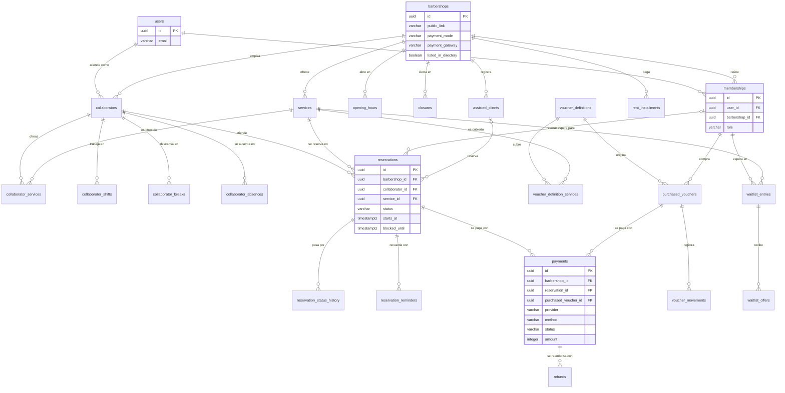

# Modelo de datos

El esquema está en tercera forma normal. Este documento describe las entidades de BarberHub, sus relaciones y sus restricciones; cada módulo ajusta las suyas en el pull request que agrega su migración (regla del final).

Las convenciones de nombres, llaves, fechas y dinero están en [database.md](database.md). Toda tabla con `barbershop_id` tiene seguridad a nivel de fila forzada, con las excepciones que lista la sección de ese documento.

> **Estado:** modelo inicial (issue #26), derivado de las reglas de negocio y de los requisitos. Las tablas `users` (#40), `barbershops` y `memberships` (#36), `services` (#45), `opening_hours` y `closures` (#47) ya existen; las demás todavía no: cada una la crea el issue de su módulo (#48 y #56, entre otros) y en ese pull request se actualiza este archivo. Es una propuesta para revisar; las decisiones que no están en los requisitos están marcadas en "Por confirmar".

## Diagrama

El diagrama omite `invitations`, `personal_access_tokens`, `webhook_events` (se describe en Pagos), `audit_log`, `http_stats` y `health_checks` para mantenerse legible; sus columnas están más abajo.

## Cuentas y acceso

### users

Cada fila es una cuenta global: una persona puede tener un rol distinto en cada barbería. La tabla existe desde el issue #40 con las columnas marcadas como creadas; las demás son previstas y las agrega el issue que se indica, con una migración posterior (`must_change_password` llegó con el #48).

| Columna | Tipo | Regla |
| --- | --- | --- |
| `id` | `uuid` | Llave primaria, `DEFAULT uuidv7()` |
| `name` | `varchar(120)` | Obligatoria |
| `email` | `varchar(255)` | Única en todo el sistema; se guarda recortada y en minúsculas (CL-01) |
| `password` | `varchar(255)` | Hash de la contraseña, nunca la contraseña (SE-01) |
| `phone` | `varchar(30)` | Admite nulos en la base; el registro la exige (RF-38) |
| `locale` | `varchar(5)` | Prevista, #47. `CHECK` entre `es` y `en`, por defecto `es` (AC-08) |
| `reminders_enabled` | `boolean` | Creada en el #95 (migración `add_reminders_enabled_to_users_table`). `NOT NULL`, por defecto `true`; solo tiene efecto para el cliente (NO-10) y solo gobierna los recordatorios: la confirmación, la oferta y los avisos de la barbería no se pueden desactivar. Se cambia con `PUT /cuenta/avisos` y se lee con `GET /cuenta/avisos` (#106); reactivarla no devuelve los recordatorios a las reservas hechas mientras estaba desactivada |
| `is_platform_operator` | `boolean` | Creada en el #293 (migración `add_is_platform_operator_to_users_table`). `NOT NULL`, por defecto `false`; `true` marca a la cuenta como operador de plataforma (RF-55, PL-01). Es una condición de la cuenta y no un rol: el operador no tiene fila en `memberships`. Solo la escribe el comando `platform:create-operator`; ninguna ruta de la API la recibe ni la cambia, y `users` es global, sin seguridad a nivel de fila |
| `must_change_password` | `boolean` | Creada en el #48. Por defecto `false`; `true` en la cuenta que el dueño crea a un colaborador con una contraseña temporal (UP-04, RF-40). Obligar el cambio en el primer ingreso es del #42 |
| `is_active` | `boolean` | Por defecto `true`; una cuenta inactiva no puede ingresar |
| `terms_accepted_at`, `privacy_accepted_at` | `timestamptz` | Fecha de cada aceptación, separadas (CL-02). Admiten nulos en la base: la cuenta de un colaborador la crea el dueño sin ellas (#48) y el registro de clientes las exige y las guarda |
| `created_at`, `updated_at` | `timestamptz` | Por defecto `now()` |

El correo es único en todo el sistema y no dentro de cada barbería: la persona ingresa con su correo antes de saber a qué barbería va. Por eso `users` no tiene política de fila. Los intentos fallidos de ingreso (SE-05) se limitan con el limitador de Laravel, no con columnas.

### memberships

El rol de una persona en una barbería (UP-01). Es la fuente de verdad de quién puede entrar a qué. La tabla existe desde el issue #36 con todas las columnas de abajo. No tiene política de fila: se lee antes de conocer la barbería (ver [database.md](database.md)).

| Columna | Tipo | Regla |
| --- | --- | --- |
| `id` | `uuid` | Llave primaria |
| `user_id` | `uuid` | Llave foránea a `users`, borrado en cascada |
| `barbershop_id` | `uuid` | Llave foránea a `barbershops`, borrado en cascada |
| `role` | `varchar(20)` | `CHECK` entre `owner`, `collaborator` y `customer` |
| `is_active` | `boolean` | Por defecto `true` |
| `created_at`, `updated_at` | `timestamptz` | Por defecto `now()` |

Llaves candidatas: `id`, `(user_id, barbershop_id)` y `(id, barbershop_id)`. La segunda garantiza un único rol por persona y barbería (UP-07); la tercera permite que otras tablas referencien la membresía junto con su barbería. Una barbería siempre conserva al menos un dueño activo (UP-05): lo verifica el caso de uso.

### invitations e invitation_services (complementaria, RF-06, #100)

La invitación de un colaborador. Es una tabla de barbería: lleva `barbershop_id`, sus llaves foráneas lo incluyen y tiene seguridad a nivel de fila forzada con su política (ver [database.md](database.md)). Una invitación **pendiente** es la que no tiene `used_at` y cuyo `expires_at` no ha llegado; **cancelarla** la borra, y con ella sus servicios.

| Columna | Tipo | Regla |
| --- | --- | --- |
| `id`, `barbershop_id` | `uuid` | Llave primaria y llave foránea a `barbershops` (`ON DELETE CASCADE`) |
| `email` | `varchar(255)` | Correo invitado, siempre en minúsculas (`CHECK email = lower(email)`) |
| `token_hash` | `char(64)` | Única; SHA-256 del token en hexadecimal (`CHECK` de 64 caracteres hexadecimales). El token nunca se guarda |
| `expires_at` | `timestamptz` | Siete días desde que se hizo la invitación (UP-04); posterior a `created_at` (`CHECK`) |
| `used_at` | `timestamptz` | Nula hasta que se usa; de un solo uso |
| `invited_by_membership_id` | `uuid` | Quién la creó; llave foránea `(invited_by_membership_id, barbershop_id)` a `memberships (id, barbershop_id)` |
| `created_at` | `timestamptz` | Por defecto `now()` |

Llaves candidatas: `id`, `token_hash` y `(id, barbershop_id)`. El índice único parcial `invitations_one_pending_per_email_idx` sobre `(barbershop_id, email)` donde `used_at IS NULL` deja una sola pendiente por correo en cada barbería: invitar de nuevo la reemplaza. El hash que se guarda al invitar es el de un token que nadie tiene; el correo sale de la cola, que crea el enlace de verdad (reemplaza el hash) y escribe el token solo en el mensaje.

`invitation_services` guarda los servicios que ofrecerá el colaborador: `id`, `barbershop_id`, `invitation_id` y `service_id`, con llaves únicas `(invitation_id, service_id)` y foráneas `(invitation_id, barbershop_id)` (`ON DELETE CASCADE`) y `(service_id, barbershop_id)`.

### personal_access_tokens y password_reset_tokens

`personal_access_tokens` la crea Sanctum y `password_reset_tokens` el #104, con el nombre que Laravel usa para esa tabla pero con columnas propias. `personal_access_tokens` (migración del #41) guarda un token por dispositivo (`token` es el hash SHA-256; `tokenable_id` es un UUID, y `abilities` queda con el valor por defecto porque el rol no viaja en el token). `password_reset_tokens` (migración del #104) guarda el hash del enlace de restablecimiento, que caduca a los 60 minutos y se borra al usarse (SE-06). Es una tabla de cuenta, global como `users`: sin barbería y sin política de fila.

| Columna | Tipo | Notas |
| --- | --- | --- |
| `user_id` | `uuid` | Llave primaria y llave foránea a `users` (`ON DELETE CASCADE`): una sola fila por cuenta, así que un enlace nuevo reemplaza al pendiente |
| `token_hash` | `char(64)` | SHA-256 del token en hexadecimal; único; `CHECK` de 64 caracteres hexadecimales. El token nunca se guarda |
| `expires_at` | `timestamptz` | Instante de la solicitud más 60 minutos; el enlace deja de valer en ese instante exacto |
| `created_at` | `timestamptz` | Instante en que se creó el enlace |

## Barbería y configuración

### barbershops

Cada fila es un inquilino. La política de cobro y la pasarela son parámetros de cada barbería (MT-04), por eso viven aquí. La tabla existe desde el issue #36, el #37 le agregó `public_link`, el #39 `payment_gateway`, el #49 la política de cobro y el #50 los indicadores de bonos y lista de espera; las columnas marcadas como previstas y las agrega el issue que se indica, con una migración posterior. No tiene política de fila: cada fila es una barbería y no lleva `barbershop_id` (ver [database.md](database.md)).

| Columna | Tipo | Regla |
| --- | --- | --- |
| `id` | `uuid` | Llave primaria, `DEFAULT uuidv7()` |
| `name` | `varchar(120)` | Obligatoria |
| `city` | `varchar(80)` | Obligatoria (RF-01) |
| `phone` | `varchar(30)` | Obligatorio; es el contacto de la barbería (RF-01) |
| `public_link` | `varchar(120)` | Obligatoria, creada en el #37. Llave única `barbershops_public_link_unique` en todo el sistema y `CHECK` `barbershops_public_link_format_check` (minúsculas, dígitos y guiones). Se deriva del nombre al registrar la barbería, con un número si ya existe, y no cambia al renombrarla (RF-02, MT-07) |
| `logo_path` | `varchar(255)` | Creada en el #46. Opcional; ruta `barbershops/{id}/logo/{uuid}.{ext}` dentro del almacén de la barbería (MT-05). Es una ruta, nunca una dirección completa |
| `banner_path` | `varchar(255)` | Creada en el #46. Opcional; ruta `barbershops/{id}/banner/{uuid}.{ext}`; el banner mide al menos 1.200 × 400 px (SV-06) |
| `payment_mode` | `varchar(10)` | Creada en el #49. Obligatoria, por defecto `none`. `CHECK` `barbershops_payment_mode_check` entre `none`, `deposit` y `full` (PA-01) |
| `deposit_percentage` | `smallint` | Creada en el #49. Nula salvo en depósito. `CHECK` `barbershops_deposit_percentage_check` entre 10 y 100 y `CHECK` `barbershops_deposit_percentage_mode_check`: tiene valor si y solo si `payment_mode` es `deposit` (PA-01) |
| `cancellation_deadline_hours` | `smallint` | Creada en el #49. Obligatoria, por defecto 24. `CHECK` `barbershops_cancellation_deadline_check` entre 0 y 720 (CA-01). Cambiarla no toca las reservas ya creadas, que guardan su copia |
| `payment_gateway` | `varchar(10)` | Creada en el #39. Admite nulos (barbería sin pasarela) y tiene el `CHECK` `barbershops_payment_gateway_check` entre `onvo` y `paypal` (PA-02). Desde el #49 el `CHECK` `barbershops_payment_gateway_required_check` exige una pasarela cuando `payment_mode` es `deposit` o `full`. Cambiarla aplica a los cobros nuevos (PA-02) |
| `vouchers_enabled`, `waitlist_enabled` | `boolean` | Creadas en el #50. Obligatorias, por defecto `false` (RF-09). Con `vouchers_enabled` en `false` no se compran ni se definen bonos nuevos (BO-01); con `waitlist_enabled` en `false` el cliente no ve la opción de anotarse (LE-01) y, desde el #93, tampoco se crean ofertas nuevas de un espacio liberado (decisión del #93: el requisito no lo dice, pero ofrecer espacios en una barbería que apagó la lista contradiría RF-09). Cambiarlas aplica a las operaciones nuevas: nunca toca los bonos comprados ni las ofertas en curso |
| `listed_in_directory` | `boolean` | Creada en el #223. Obligatoria, por defecto `false` (RF-54, MT-10). Con `true` la barbería figura en el directorio público `GET /api/v1/directorio`; con `false` sigue accesible por su enlace (MT-07). Lo cambia solo el dueño, junto con `vouchers_enabled` y `waitlist_enabled` |
| `created_at`, `updated_at` | `timestamptz` | Por defecto `now()` |

Las credenciales de las pasarelas no se guardan aquí: viven en variables de entorno. Si cada barbería necesita su propia cuenta de cobro, queda por definir en PD-07.

### services

La tabla existe desde el issue #45 con las columnas marcadas como creadas; `image_path` la agregó el #46 con una migración posterior. Tiene la política de fila `services_barbershop_isolation` (ver [database.md](database.md)). Un servicio nunca se borra: se inactiva (SV-04).

| Columna | Tipo | Regla |
| --- | --- | --- |
| `id` | `uuid` | Llave primaria, `DEFAULT uuidv7()` |
| `barbershop_id` | `uuid` | Llave foránea a `barbershops`, borrado en cascada |
| `name` | `varchar(120)` | Obligatoria. No es única: los requisitos no lo piden |
| `duration_minutes` | `smallint` | `CHECK` `services_duration_minutes_check`: entre 10 y 180 y múltiplo de 5 (SV-01) |
| `price` | `integer` | Colones enteros con IVA incluido, `CHECK` `services_price_check`: mayor que 0 (SV-01, SV-02). La base y el impuesto no se guardan: se calculan (SV-02) |
| `image_path` | `varchar(255)` | Creada en el #46. Opcional; ruta `barbershops/{id}/servicios/{uuid}.{ext}`; JPG, PNG o WebP de hasta 2 MB (SV-06). Sin imagen, el servicio se muestra sin ella (SV-07) |
| `is_active` | `boolean` | Por defecto `true` (SV-04) |
| `created_at`, `updated_at` | `timestamptz` | Por defecto `now()` |

Llaves candidatas: `id` y `(id, barbershop_id)`.

El impuesto de un precio es `precio × 13 / 113` redondeado al colón más cercano (la mitad hacia arriba), y la base es `precio − impuesto`; así `base + impuesto = precio`. Por ejemplo, ₡7.000 son ₡6.195 de base y ₡805 de IVA, y ₡7.500 son ₡6.637 y ₡863 (RL-02).

### opening_hours y closures

El horario semanal de la barbería y sus cierres por fecha (HO-01). Las dos tablas existen desde el issue #47 y tienen su política de fila `<tabla>_barbershop_isolation` (ver [database.md](database.md)). No hay tabla de excepciones con horario especial: las excepciones por fecha son solo cierres (ver la decisión más abajo).

| Tabla | Columnas | Regla |
| --- | --- | --- |
| `opening_hours` | `id`, `barbershop_id` (llave foránea en cascada), `day_of_week` (`smallint`), `opens_at` y `closes_at` (`time` sin zona), `created_at`, `updated_at` | `CHECK` `opening_hours_day_of_week_check`: `day_of_week` entre 1 (lunes) y 7 (domingo). `CHECK` `opening_hours_opens_at_check`: `opens_at < closes_at`. `EXCLUDE` `opening_hours_no_overlap_excl` sobre `(barbershop_id, day_of_week, timerange(opens_at, closes_at))` impide franjas con un minuto en común el mismo día de la misma barbería; las contiguas (09:00–12:00 y 12:00–15:00) se permiten porque el fin está excluido. Llaves candidatas: `id` y `(id, barbershop_id)` |
| `closures` | `id`, `barbershop_id` (llave foránea en cascada), `closed_on` (`date`), `reason` (`varchar(200)`, opcional), `created_at`, `updated_at` | Única `(barbershop_id, closed_on)`: una fecha se cierra una sola vez. Llaves candidatas: `id` y `(id, barbershop_id)` |

Los días de la semana sin franjas están cerrados. Si la fecha tiene un cierre, ese día no tiene espacios aunque el horario semanal los tenga; sin cierre rige el horario semanal. Las horas no llevan zona horaria: son horas de pared de la barbería, que opera en `America/Costa_Rica` (HO-03).

La migración de `opening_hours` crea la extensión `btree_gist` y el tipo `timerange` (ver [database.md](database.md)); su `down()` los elimina para que `migrate:fresh` siga funcionando. El solape se rechaza primero en el caso de uso (`TimeSlotOverlapsException`) y el repositorio traduce la violación `23P01` de la restricción a la misma excepción; un cierre repetido se rechaza en el caso de uso y, como segunda barrera, la violación de la llave única (`ClosureAlreadyExistsException`).

**Solo cierres, sin horario especial (decisión del #47).** RF-04 pide «días cerrados y excepciones por fecha», pero el flujo solo describe marcar feriados y cierres especiales, y los criterios solo piden eliminar los espacios de un día cerrado. Por eso una fecha o está cerrada o rige el horario semanal; abrir un feriado con otro horario no se modela. Si más adelante se necesita, se agrega una tabla de franjas por fecha sin cambiar `closures`.

Lo que todavía no existe: HO-04 (mostrar al dueño las reservas confirmadas que quedan fuera de un nuevo horario o dentro de un cierre) necesita la tabla `reservations`, que creó el #126. Ningún issue abierto pide todavía el endpoint de esa lista (el #76 solo la menciona desde la interfaz), así que queda pendiente de asignar.

### collaborators

El perfil con agenda: la persona que atiende. Existe desde el issue #48. Un dueño que corta (CO-02) conserva su membresía `owner` y además tiene un perfil aquí. Tiene la política de fila `collaborators_barbershop_isolation` (ver [database.md](database.md)).

| Columna | Tipo | Regla |
| --- | --- | --- |
| `id` | `uuid` | Llave primaria, `DEFAULT uuidv7()` |
| `barbershop_id` | `uuid` | Llave foránea a `barbershops`, borrado en cascada |
| `user_id` | `uuid` | Llave foránea a `users`, borrado en cascada |
| `is_active` | `boolean` | Por defecto `true`; no se desactiva con reservas futuras confirmadas (CO-03), comprobación que llega con la creación de reservas (#56), ahora que la tabla existe (#126) |
| `created_at`, `updated_at` | `timestamptz` | `created_at` es la antigüedad de alta que desempata «cualquiera disponible» (DI-04) |

Llaves candidatas: `id`, `(barbershop_id, user_id)` (un perfil por persona y barbería, CO-01) y `(id, barbershop_id)`, para que otras tablas referencien el perfil junto con su barbería.

**Corrección de un borrador.** El borrador de este documento ligaba el perfil a la membresía con `membership_id`. Se corrigió a `user_id` en el #48: el rol vive en `memberships` (UP-07, un único rol por persona y barbería) y el perfil es lo que tiene agenda, servicios, horario y pausas, así que el perfil del dueño no depende de su membresía ni crea otra. Crear un colaborador común crea tres cosas en una sola transacción: la cuenta (con `must_change_password`), la membresía `collaborator` y el perfil. Desactivar a un colaborador común desactiva también su membresía; la del dueño con perfil no se toca nunca (UP-05).

### collaborator_services, collaborator_shifts y collaborator_breaks

Existen desde el issue #48 y cada una tiene su política de fila `<tabla>_barbershop_isolation`. Todas las llaves foráneas incluyen `barbershop_id`: un servicio y un colaborador de barberías distintas no se pueden relacionar. Se reemplazan completas cada vez que el dueño cambia los servicios o el horario.

| Tabla | Columnas | Regla |
| --- | --- | --- |
| `collaborator_services` | `id`, `barbershop_id`, `collaborator_id`, `service_id` | Única `(collaborator_id, service_id)`. Llaves foráneas compuestas `(collaborator_id, barbershop_id)` a `collaborators` (en cascada) y `(service_id, barbershop_id)` a `services` (sin cascada: un servicio nunca se borra, SV-04). Define los servicios habilitados (CO-01) |
| `collaborator_shifts` | `id`, `barbershop_id`, `collaborator_id`, `day_of_week` (`smallint`), `starts_at` y `ends_at` (`time` sin zona), `created_at`, `updated_at` | `CHECK` de día entre 1 (lunes) y 7 (domingo) y de `starts_at < ends_at`. `EXCLUDE collaborator_shifts_no_overlap_excl` sobre `(barbershop_id, collaborator_id, day_of_week, timerange(starts_at, ends_at))`: los turnos de un colaborador no se traslapan, los contiguos sí se permiten. Llaves candidatas: `id` y `(id, barbershop_id)` |
| `collaborator_breaks` | las mismas que los turnos | Los mismos `CHECK` y una `EXCLUDE collaborator_breaks_no_overlap_excl` equivalente: las pausas de un colaborador no se traslapan |

**Correcciones de un borrador.** El borrador daba a `collaborator_services` la llave primaria `(collaborator_id, service_id)`. La convención del esquema (RD-06, verificada por `SchemaConventionsTest`) pide un `id` uuid en toda tabla, así que ese par es una llave única y no la primaria. La tabla sigue sin `created_at`, porque nadie lo lee.

Lo que la base no puede verificar lo verifica el caso de uso `ReplaceSchedule` (HO-02): cada turno cae dentro de las franjas del horario de la barbería de ese día (se unen las franjas contiguas, así que un turno de 10:00 a 14:00 cabe en 09:00–12:00 más 12:00–15:00) y cada pausa cae dentro de un turno del mismo día. El solape lo rechaza primero el dominio (`WorkSchedule`) y la restricción es la segunda barrera: el repositorio traduce el SQLSTATE `23P01` a `ShiftsOverlapException` o `BreaksOverlapException`.

### collaborator_absences

Existe desde el issue #101 (RF-07, CO-06), con la política de fila `collaborator_absences_barbershop_isolation`. Un bloqueo es un solo intervalo `[starts_at, ends_at)`: sin horas, de la medianoche del primer día a la del día siguiente al último; con horas, de la hora inicial del primer día a la hora final del último. Las horas son de Costa Rica (HO-03).

| Columna | Tipo | Regla |
| --- | --- | --- |
| `id`, `barbershop_id` | `uuid` | Llave primaria y llave foránea a `barbershops` en cascada. Llave candidata `(id, barbershop_id)` |
| `collaborator_id` | `uuid` | Llave foránea compuesta `(collaborator_id, barbershop_id)` a `collaborators`, en cascada: un bloqueo no apunta a un colaborador de otra barbería |
| `starts_at`, `ends_at` | `timestamptz` | `CHECK (starts_at < ends_at)` |
| `reason` | `varchar(200)` | Opcional |
| `created_at`, `updated_at` | `timestamptz` | |

El índice `collaborator_absences_lookup_idx` `(barbershop_id, collaborator_id, starts_at, ends_at)` sirve a la disponibilidad. **No lleva `EXCLUDE`**: dos bloqueos del mismo colaborador pueden traslaparse, porque bloquear dos veces el mismo tiempo no cambia nada; que no haya reservas dentro lo garantiza el caso de uso `RegisterAbsence` con el bloqueo de la fila del colaborador (ver «Los bloqueos de agenda (#101)» en `architecture.md`).

## Alquiler de la plataforma

### rent_installments

La cuota mensual de alquiler que una barbería paga a la plataforma (RF-57, PL-04, PL-05). Existe desde el issue #295 (migración `create_rent_installments_table`), con la política de fila `rent_installments_barbershop_isolation` (ver [database.md](database.md)). Cada fila es el alquiler de **un mes**: guarda el monto con que nació y el día en que vence.

| Columna | Tipo | Regla |
| --- | --- | --- |
| `id`, `barbershop_id` | `uuid` | Llave primaria (UUID v7, con `DEFAULT uuidv7()` de respaldo) y llave foránea a `barbershops` en cascada. Llave candidata `(id, barbershop_id)` |
| `amount` | `integer` | Colones enteros con IVA de 13 % incluido; `CHECK (amount > 0)`. Se copia del alquiler vigente al crear la cuota y **nunca cambia**: modificar el monto vigente solo afecta a las cuotas que se creen después (la cuota es el hecho de cuánto se debía ese mes, como el precio de una reserva, SV-03) |
| `due_on` | `date` | Día de vencimiento en hora de Costa Rica (HO-03): el día del mes en que se dio de alta la barbería o, si el mes no lo tiene, el último día del mes (PL-05) |
| `status` | `varchar(20)` | `pending` (por defecto) o `paid`; `CHECK` `rent_installments_status_check`. Pagar es del RF-59: este issue solo crea cuotas pendientes |
| `created_at`, `updated_at` | `timestamptz` | |

La llave única `rent_installments_due_unique` `(barbershop_id, due_on)` es la idempotencia: una barbería tiene una cuota por vencimiento, y la generación inserta con `ON CONFLICT DO NOTHING`, así que dos ejecuciones el mismo día (o dos procesos a la vez) no duplican nada. **No hay contador de meses pendientes**: son las cuotas con `status = 'pending'` y `due_on` anterior al día de hoy en Costa Rica, contadas (consulta `CountPendingRentMonths`). Una cuota que vence hoy todavía no está vencida: lo está desde la medianoche de Costa Rica.

## Reservas

### assisted_clients

La persona que el dueño registra para una reserva asistida, sin cuenta (CL-06). Existe solo dentro de su barbería. La tabla existe desde el issue #102 (migración `create_assisted_clients_table`), con la política de fila `assisted_clients_barbershop_isolation` (ver [database.md](database.md)). No es una cuenta ni una membresía: no está en `users` ni en `memberships`, no inicia sesión y nadie la ve fuera de la barbería que la creó.

| Columna | Tipo | Regla |
| --- | --- | --- |
| `id`, `barbershop_id` | `uuid` | Llave primaria y llave foránea a `barbershops` |
| `name` | `varchar(120)` | Obligatoria; `CHECK` `assisted_clients_name_check`: no vacía |
| `phone` | `varchar(30)` | Obligatoria; `CHECK` `assisted_clients_phone_check`: no vacío |
| `email` | `varchar(255)` | Opcional; sin correo no recibe avisos ni recordatorios. `CHECK` `assisted_clients_email_check`: nulo o no vacío |
| `created_at`, `updated_at` | `timestamptz` | |

Llaves: `id` y `(id, barbershop_id)`, para que `reservations` la referencie junto con su barbería. El índice `assisted_clients_name_idx` `(barbershop_id, name)` sirve a la búsqueda del dueño por nombre o teléfono (`ILIKE`). **Nada es único**: dos personas pueden compartir un teléfono y el dueño elige entre los resultados de la búsqueda. Desde el #102 el cliente asistido se registra dentro de la reserva (`POST .../reservas/asistida`), en la misma transacción: si el espacio ya no está libre, la transacción se deshace y no queda ningún cliente huérfano.

### reservations

El espacio de un colaborador asignado a un cliente para un servicio (RE-03). Es el agregado más importante. La tabla existe desde el issue #126 con las columnas marcadas como creadas; las demás son previstas y las agrega el issue de su función, con una migración posterior. Tiene la política de fila `reservations_barbershop_isolation` (ver [database.md](database.md)).

| Columna | Tipo | Regla |
| --- | --- | --- |
| `id` | `uuid` | Creada en el #126. Llave primaria, `DEFAULT uuidv7()` |
| `barbershop_id` | `uuid` | Creada en el #126. Llave foránea a `barbershops`, borrado en cascada |
| `collaborator_id`, `service_id` | `uuid` | Creadas en el #126. Llaves foráneas compuestas con `barbershop_id` a `collaborators` y `services`, sin cascada: un servicio nunca se borra (SV-04) y un colaborador con reservas tampoco |
| `customer_membership_id` | `uuid` | Creada en el #126. Llave foránea compuesta a `memberships`. Opcional desde el #102: nula en una reserva asistida |
| `assisted_client_id` | `uuid` | Creada en el #102 (migración `add_assisted_client_to_reservations_table`). Opcional; llave foránea compuesta `(assisted_client_id, barbershop_id)` a `assisted_clients`, sin cascada. Índice parcial `reservations_assisted_client_idx` |
| `created_by_membership_id` | `uuid` | Creada en el #102. Opcional; el rol de dueño que registró la reserva asistida. Llave foránea compuesta `(created_by_membership_id, barbershop_id)` a `memberships` |
| `purchased_voucher_id` | `uuid` | Creada en el #89 (migración `add_purchased_voucher_to_reservations_table`). Opcional; el bono cuya sesión paga la reserva (RF-28). Llave foránea compuesta `(purchased_voucher_id, barbershop_id)` a `purchased_vouchers`, sin cascada: una reserva solo usa un bono de su barbería (MT-04, BO-07). Índice parcial `reservations_purchased_voucher_idx` sobre `(barbershop_id, purchased_voucher_id)` |
| `status` | `varchar(30)` | Creada en el #126. `CHECK` entre los siete estados de RE-04 |
| `starts_at`, `ends_at` | `timestamptz` | Creadas en el #126. Inicio y fin del servicio; `CHECK (starts_at < ends_at)` |
| `blocked_until` | `timestamptz` | Creada en el #126. Fin del servicio más 5 minutos de limpieza; `CHECK (ends_at <= blocked_until)`. El dominio la calcula (`Reservation::CLEANUP_MINUTES`) |
| `price` | `integer` | Creada en el #126. Precio vigente al reservar (SV-03); `CHECK` mayor que 0 |
| `duration_minutes` | `smallint` | Creada en el #126. Duración vigente al reservar (SV-03); `CHECK` mayor que 0, sin repetir el rango del servicio para que un cambio del catálogo no invalide reservas existentes |
| `cancellation_deadline_hours` | `smallint` | Creada en el #126. Plazo de cancelación vigente al reservar (CA-01); `CHECK` mayor o igual que 0. Desde el #49 es la copia de `barbershops.cancellation_deadline_hours` al momento de reservar |
| `deposit_amount` | `integer` | Prevista, con el pago (PA-06). `CHECK` mayor o igual que 0; depósito calculado al reservar |
| `expires_at` | `timestamptz` | Creada en el #66. Nula salvo en las temporales: la hora límite de pago, 10 minutos después de crearse (`Reservation::PAYMENT_WINDOW_MINUTES`, RE-05). `CHECK` `reservations_expires_at_check`: `expires_at IS NULL OR status = 'temporary'`; por eso confirmar, expirar o cancelar la reserva la deja en nulo |
| `reschedule_count` | `smallint` | Creada en el #126. `CHECK` entre 0 y 2 (CA-05); por defecto 0. Aumentarla es de reprogramar (#59) |
| `created_at`, `updated_at` | `timestamptz` | Creadas en el #126. Por defecto `now()` |

Restricciones:

- `reservations_customer_check` (#102): `CHECK (num_nonnulls(customer_membership_id, assisted_client_id) = 1)`: la reserva es de una cuenta o de un cliente asistido, nunca de ambos ni de ninguno. Es la forma mínima de que «el cliente» sea una cosa o la otra: dos columnas con llaves foráneas compuestas que cargan la barbería (MT-04), en vez de una columna polimórfica que no podría tener llave foránea, y la restricción está en la base, no solo en el código. El agregado `Reservation` lo repite: su constructor rechaza una reserva de ambos o de ninguno.
- `reservations_no_overlap_excl` (#126): un colaborador no tiene dos reservas temporales o confirmadas con intervalos solapados, incluida la limpieza (RE-01). Ver [database.md](database.md).
- `reservations_customer_no_overlap_excl` (#126), sobre `(barbershop_id, customer_membership_id, tstzrange(starts_at, ends_at))`, solo para el estado `confirmed`: un cliente no tiene dos reservas confirmadas solapadas en la barbería (RE-06). No incluye la limpieza: es el tiempo del servicio, no el del colaborador. Como un nulo nunca es igual a otro, la restricción ignora las reservas asistidas: **RE-06 no se aplica a un cliente asistido** (decisión del #102; el dueño ve la agenda y elige el espacio, y ni `requirements.md` ni el modelo piden más). Si hiciera falta, bastaría una exclusión gemela sobre `assisted_client_id`.
- Llaves candidatas: `id` y `(id, barbershop_id)`, para que otras tablas referencien la reserva junto con su barbería.

**Expiración perezosa (#66).** Una temporal vencida (`expires_at <= ahora`) no ocupa el espacio aunque su estado siga siendo `temporary`: la consulta de intervalos bloqueados la ignora (DI-05) y las lecturas la muestran `expirada` sin escribir. El estado se actualiza a `expired` la próxima vez que se reserva o reprograma con ese colaborador (ya bloqueado), antes de revalidar la disponibilidad, para que la exclusión `reservations_no_overlap_excl` no choque con la vencida. **Pendiente:** la devolución de un pago que llega después del vencimiento (PA-07).

Las dos exclusiones se aplican solo a los estados que ocupan el espacio: una reserva completada, ausente, cancelada o expirada lo libera al cambiar de estado. Las reservas contiguas (el inicio de una es el fin del bloqueo de la anterior) se permiten. Son la segunda barrera: el dominio y la disponibilidad rechazan primero (#56), y el SQLSTATE `23P01` que llega de la base lo traduce `EloquentReservationRepository` según la restricción: `espacio-no-disponible` para la del colaborador y un conflicto (`reserva-solapada`, tipo `conflicto`) para la del cliente.

El saldo pendiente por cobrar en el local (PA-10) es `price - deposit_amount` y no se guarda.

### reservation_status_history

Cada cambio de estado, con fecha y autor (RE-09). Existe desde el issue #126, con la política de fila `reservation_status_history_barbershop_isolation`. Solo se inserta: nunca se actualiza, y solo se borra junto con su reserva. El agregado acumula sus cambios (`ReservationStatusChange`) y el repositorio los guarda en la misma transacción que el estado, incluida la creación.

| Columna | Tipo | Regla |
| --- | --- | --- |
| `id`, `barbershop_id`, `reservation_id` | `uuid` | Llave primaria (`DEFAULT uuidv7()`), llave foránea a `barbershops` y llave foránea compuesta `(reservation_id, barbershop_id)` a `reservations`, en cascada |
| `from_status` | `varchar(30)` | Nula en la creación. `CHECK` entre los siete estados |
| `to_status` | `varchar(30)` | `CHECK` entre los siete estados |
| `changed_by_user_id` | `uuid` | Nula cuando cambia el sistema (webhook, expiración). Llave foránea a `users` |
| `changed_at` | `timestamptz` | El instante que recibe el dominio |

**Corrección de un borrador.** El borrador llamaba al autor `changed_by_membership_id`. Se corrigió a `changed_by_user_id` en el #126: el autor que recibe el dominio es una persona (`UserId`, de `Shared`) o el sistema, y las membresías son de `Identity`, que `Reservations` no importa.

### reservation_reminders

Los recordatorios de una reserva, uno por tipo, y la garantía de que ninguno sale dos veces (NO-03). La tabla existe desde el issue #95 (migración `create_reservation_reminders_table`). Tiene la política de fila `reservation_reminders_barbershop_isolation` (ver [database.md](database.md)).

| Columna | Tipo | Regla |
| --- | --- | --- |
| `id` | `uuid` | Llave primaria, `DEFAULT uuidv7()` |
| `barbershop_id` | `uuid` | Llave foránea a `barbershops`, en cascada |
| `reservation_id` | `uuid` | Llave foránea compuesta `(reservation_id, barbershop_id)` a `reservations`, en cascada: un recordatorio solo apunta a una reserva de su barbería (MT-04) |
| `kind` | `varchar(3)` | `CHECK` `reservation_reminders_kind_check` entre `24h` y `2h` (NO-02) |
| `scheduled_for` | `timestamptz` | El instante en que vence. Reprogramar la reserva lo reescribe y deja `sent_at` en nulo; la tarea de la cola que lleva el instante viejo ya no encuentra una fila con él y no envía nada |
| `sent_at` | `timestamptz` | Nulo hasta que se reclama para enviarlo. Se escribe con un `UPDATE ... WHERE sent_at IS NULL AND scheduled_for = ?`, así que dos tareas simultáneas no pueden ganar las dos |
| `created_at` | `timestamptz` | Por defecto, la hora de la inserción |

Llaves: `(id, barbershop_id)` y la candidata `(barbershop_id, reservation_id, kind)`, sobre la que se apoya el `INSERT ... ON CONFLICT`: repetir el aviso de confirmación para la misma hora no cambia la fila (no vuelve a dejar pendiente un recordatorio ya enviado). Una reserva sin recordatorios (cliente sin correo o con ellos desactivados, o con menos de 24 h o 2 h de anticipación) simplemente no tiene fila de ese tipo.

## Pagos

### payments

El cobro de una reserva (RF-20). La tabla existe desde el issue #129 con las columnas marcadas como creadas. Tiene la política de fila `payments_barbershop_isolation` (ver [database.md](database.md)). Desde el #88 también es el cobro de la compra de un bono (RF-27): la migración `add_purchased_voucher_to_payments_table` agrega `purchased_voucher_id`, vuelve opcional `reservation_id` y exige que el pago sea de una reserva o de un bono, nunca de ambos ni de ninguno.

| Columna | Tipo | Regla |
| --- | --- | --- |
| `id`, `barbershop_id` | `uuid` | Llave primaria (`DEFAULT uuidv7()`) y llave foránea a `barbershops`, en cascada |
| `reservation_id` | `uuid` | Opcional desde el #88 (nula si el pago es de un bono). Llave foránea compuesta `(reservation_id, barbershop_id)` a `reservations`, sin cascada: una reserva con pagos no se borra |
| `purchased_voucher_id` | `uuid` | Migración del #88. Nula si el pago es de una reserva. Llave foránea compuesta `(purchased_voucher_id, barbershop_id)` a `purchased_vouchers`, sin cascada: un bono con pagos no se borra, así que un pago nunca apunta a un bono de otra barbería (MT-04). `CHECK` `payments_one_subject_check`: exactamente una de las dos, `reservation_id` o `purchased_voucher_id` |
| `provider` | `varchar(10)` | `CHECK` `payments_provider_check` entre `onvo` y `paypal`; el proveedor vigente al crear el cobro, que no cambia aunque el dueño cambie la pasarela (PA-02, RF-23) |
| `method` | `varchar(20)` | `CHECK` `payments_method_check` entre `card` y `sinpe_movil` |
| `status` | `varchar(10)` | `CHECK` `payments_status_check` entre `pending`, `approved`, `rejected`, `failed` y `refunded` |
| `amount` | `integer` | Colones enteros que paga el cliente (PA-06); `CHECK` mayor que 0 |
| `provider_currency`, `provider_amount` | `char(3)`, `integer` | Moneda y monto en la unidad mínima del proveedor, solo para trazabilidad. Nulos hasta que el proveedor crea el cobro; `CHECK` `payments_provider_currency_amount_check`: ambos tienen valor o ninguno, y `provider_amount` mayor que 0 |
| `provider_exchange_rate` | `integer` | Migración del #64. Diezmilésimas de colón por unidad de la moneda del proveedor con que se convirtió el monto (PayPal cobra en USD; ₡500 por dólar es `5000000`, entero como todo número del esquema, RD-06); nulo si no hubo conversión. `CHECK` `payments_provider_exchange_rate_check`: solo con `provider_amount` y mayor que 0 |
| `provider_capture_id` | `varchar(100)` | Migración del #64. Identificador de la captura que liquidó el cobro (PayPal); nulo para los demás. Es lo que necesitaría un reembolso |
| `provider_payment_id` | `varchar(100)` | Identificador del cobro en el proveedor. Nulo hasta crearlo; `CHECK` `payments_provider_payment_id_check`: un pago aprobado o reembolsado lo tiene |
| `failure_reason` | `varchar(255)` | Motivo de un rechazo o un fallo; `CHECK` `payments_failure_reason_check`: solo con `rejected` o `failed` |
| `refund_pending` | `boolean` | Por defecto `false` (migración del #63). Marca el pago aprobado que hay que devolver: cuando la reserva ya no se pudo confirmar (PA-07) y cuando la reserva se cancela a tiempo o por la barbería (CA-02, CA-04, #67), una sola vez; «retenido» (cancelación tardía o ausencia, CA-03) es un pago aprobado sin la marca y no se guarda; `CHECK` `payments_refund_pending_check`: solo con `approved`. El reembolso la limpia |
| `created_at`, `updated_at` | `timestamptz` | Por defecto `now()`; el repositorio escribe los instantes que decide el agregado |

Restricciones:

- Llaves candidatas: `(id, barbershop_id)` y `(provider, provider_payment_id)`. Esta última es única entre todas las barberías porque el proveedor no las conoce; varias filas sin identificador (cobros aún no creados) conviven, ya que `NULL` no choca consigo mismo.
- `payments_one_active_per_reservation_idx`: índice único parcial sobre `(barbershop_id, reservation_id)` donde `status` es `pending` o `approved`. Una reserva tiene un solo pago en curso o aprobado; uno rechazado, fallido o reembolsado la libera para un cobro nuevo. Es la idempotencia del botón de pagar: `EloquentPaymentRepository` traduce su violación (`23505`) a `ActivePaymentExistsException`.
- `payments_one_active_per_voucher_idx`: índice único parcial sobre `(barbershop_id, purchased_voucher_id)` donde `status` es `pending` o `approved` (#88). Un bono comprado tiene un solo pago en curso o aprobado, y uno rechazado o fallido lo libera para reintentar: es la idempotencia del botón de comprar, igual que la de la reserva. `EloquentPaymentRepository` traduce su violación a `ActivePaymentExistsException` como la del índice de reservas. El bono se activa una sola vez por el índice único `voucher_movements_one_purchase_idx` de su registro.
- El estado del pago se obtiene siempre consultando al proveedor; el aviso (webhook) solo dispara esa consulta (#65). Los avisos ya aplicados viven en `webhook_events`, más abajo.

### refunds (complementaria, RF-24)

El «depósito a devolver» de CA-02 es un reembolso en estado `due`.

**Todavía no existe.** Mientras RF-24 (M14) no cree la tabla, un reembolso es un pago en estado `refunded` por su monto completo, y el reporte de ingresos (RF-25, #91) fecha el cobro y el reembolso con las columnas que `payments` ya tiene: el cobro, con `created_at` (el pago no guarda cuándo se aprobó, solo que se aprobó momentos después de crearse) y el reembolso, con `updated_at` (un pago reembolsado es final, así que su último cambio es el reembolso). Un pago aprobado con `refund_pending` sigue contando como cobrado hasta que se reembolsa. RF-24 traerá fechas propias (`refunds.completed_at` y la aprobación del pago) y entonces el reporte las usará, y solo restarán los reembolsos `completed`; una prueba (`IncomeReportTest`) fija hoy que el reembolso se ubica por `updated_at`.

El reporte no tiene tabla de ingresos: suma `payments` de reservas (cobrado en línea; los pagos de un bono no entran, son la venta del bono), `purchased_vouchers` activos por `activated_at` y con el `price` con que se vendieron (bonos vendidos) y `reservations` completadas por `starts_at` y con su `price` (servicios atendidos). Los días son los de `America/Costa_Rica`, con el rango `[desde 00:00, hasta + 1 día 00:00)`.

| Columna | Tipo | Regla |
| --- | --- | --- |
| `id`, `barbershop_id`, `payment_id` | `uuid` | Llave primaria y llaves foráneas compuestas |
| `amount` | `integer` | `CHECK` mayor que 0 |
| `reason` | `varchar(30)` | `CHECK` entre `cancelled_in_time`, `cancelled_by_barbershop` y `late_confirmation` |
| `status` | `varchar(10)` | `CHECK` entre `due`, `pending`, `completed` y `failed` (PA-08) |
| `gateway_reference` | `varchar(255)` | Opcional |
| `completed_at`, `created_at`, `updated_at` | `timestamptz` | |

### webhook_events

Los avisos de la pasarela que ya se aplicaron, una sola vez cada uno (PA-05, #65). La fila se escribe en la misma transacción que su efecto (la liquidación del pago y la confirmación de la reserva): un aviso que falla a medias no queda registrado y la pasarela lo reintenta. Solo se registran los avisos de un pago conocido; uno de un pago desconocido o de un evento que el sistema no usa no deja fila.

| Columna | Tipo | Regla |
| --- | --- | --- |
| `id` | `uuid` | Llave primaria |
| `gateway` | `varchar(10)` | `CHECK` entre `onvo` y `paypal` |
| `event_id` | `varchar(255)` | Identificador del evento en la pasarela (`id` del evento de ONVO; `id` de la notificación de PayPal) |
| `event_type` | `varchar(100)` | |
| `payment_id` | `uuid` | El pago al que se aplicó. No es nula: solo se registra un aviso de un pago conocido. Sin llave foránea: un pago nunca se borra |
| `received_at`, `processed_at` | `timestamptz` | Ambas se escriben al aplicar el aviso |

Llave candidata: `(gateway, event_id)`; su violación es lo que convierte un aviso repetido en una operación sin efecto (`INSERT ... ON CONFLICT DO NOTHING`). No lleva `barbershop_id` ni política: es una de las excepciones de [database.md](database.md). El caso de uso bloquea el pago (`SELECT ... FOR UPDATE`) antes de insertar la fila, así dos avisos del mismo pago corren por turnos (la prueba `SimultaneousNoticesTest` lo cubre con conexiones paralelas).

## Bonos

Las cuatro tablas existen desde el issue #132, con la seguridad a nivel de fila de [database.md](database.md). Las rutas de definir bonos llegan con el #87; las de comprar, usar y consultar, con el #88 al #90. El #89 no agrega rutas: reservar con bono es el campo `con_bono` de crear la reserva y la reserva guarda el bono usado en `reservations.purchased_voucher_id`.

### voucher_definitions y voucher_definition_services

El bono que la barbería vende (BO-01) y los servicios que cubre.

| Tabla | Columnas | Regla |
| --- | --- | --- |
| `voucher_definitions` | `id`, `barbershop_id`, `name` (`varchar(120)`), `sessions_count` (`smallint`), `price` (`integer`, colones con IVA), `validity_days` (`smallint`), `is_active`, `created_at`, `updated_at` | `CHECK` de `sessions_count`, `price` y `validity_days` mayores que 0 y de `name` no vacío; `is_active = false` lo retira de la venta (RF-26) |
| `voucher_definition_services` | `id`, `barbershop_id`, `voucher_definition_id`, `service_id`, `created_at` | Única `(barbershop_id, voucher_definition_id, service_id)`; llaves foráneas compuestas a `voucher_definitions` (se borra con él) y a `services`; índice `(barbershop_id, service_id)` para saber qué bonos cubren un servicio (BO-06) |

### purchased_vouchers

El bono adquirido por un cliente: un agregado con su saldo en sesiones.

| Columna | Tipo | Regla |
| --- | --- | --- |
| `id`, `barbershop_id` | `uuid` | Llave primaria y llave foránea a `barbershops` |
| `customer_membership_id` | `uuid` | Llave foránea compuesta `(customer_membership_id, barbershop_id)` a `memberships` |
| `voucher_definition_id` | `uuid` | Llave foránea compuesta `(voucher_definition_id, barbershop_id)` a `voucher_definitions` |
| `name`, `price`, `sessions_count`, `validity_days` | `varchar(120)`, `integer`, `smallint`, `smallint` | Copiados de la definición al comprar, todos con `CHECK` (nombre no vacío y números mayores que 0) |
| `status` | `varchar(10)` | `CHECK` entre `pending` y `active`; pasa a `active` solo cuando el webhook confirma el pago (BO-02) |
| `activated_at`, `expires_at` | `timestamptz` | Nulas hasta la activación; `expires_at` es `activated_at` más `validity_days` días |
| `remaining_sessions` | `smallint` | Por defecto 0. `CHECK (remaining_sessions >= 0)` (BO-03) y `CHECK (remaining_sessions <= sessions_count)` |
| `created_at`, `updated_at` | `timestamptz` | |

Una cuarta restricción, `purchased_vouchers_activation_check`, une el estado con las fechas: un bono `pending` no tiene fechas ni sesiones, y uno `active` tiene las dos fechas y `expires_at > activated_at`. Índices: `purchased_vouchers_customer_idx` sobre `(barbershop_id, customer_membership_id, expires_at)` para los bonos de una persona, el que vence antes primero (BO-08), y el parcial `purchased_vouchers_expiring_idx` sobre `(barbershop_id, expires_at)` para los activos con sesiones, que son los que están por vencer.

Un bono vencido no cambia de estado: la vigencia se valida al reservar y al consultar el saldo (BO-07).

### voucher_movements

El registro de cada movimiento de saldo, ligado a su reserva (BO-09). Solo se agrega: nunca se edita ni se borra una fila.

| Columna | Tipo | Regla |
| --- | --- | --- |
| `id`, `barbershop_id` | `uuid` | Llave primaria y llave foránea a `barbershops` |
| `purchased_voucher_id` | `uuid` | Llave foránea compuesta `(purchased_voucher_id, barbershop_id)` |
| `reservation_id` | `uuid` | Nula solo en la compra; llave foránea compuesta `(reservation_id, barbershop_id)` a `reservations` |
| `type` | `varchar(10)` | `CHECK` entre `purchase`, `hold`, `consume` y `release` |
| `sessions_delta` | `smallint` | `purchase` suma las sesiones compradas, `hold` resta una, `release` devuelve una y `consume` confirma el uso con 0 |
| `created_at` | `timestamptz` | |

`voucher_movements_shape_check` obliga a que cada tipo lleve su monto y que solo la compra no tenga reserva, así que la suma de los movimientos de un bono es su saldo. Tres índices únicos parciales dan la idempotencia: una sola compra por bono, un solo `hold` por bono y reserva, y una sola salida (`release` o `consume`) por bono y reserva. Los índices `voucher_movements_voucher_idx` `(barbershop_id, purchased_voucher_id, created_at)` y `voucher_movements_reservation_idx` `(barbershop_id, reservation_id)` sirven para sumar y para leer el registro. Que nunca se edite ni se borre lo garantizan los permisos y un disparador (ver [database.md](database.md)).

## Lista de espera

### waitlist_entries

La fila de un cliente para un servicio y un día (LE-01).

| Columna | Tipo | Regla |
| --- | --- | --- |
| `id`, `barbershop_id` | `uuid` | Llave primaria y llave foránea a `barbershops` |
| `customer_membership_id`, `service_id` | `uuid` | Llaves foráneas compuestas |
| `collaborator_id` | `uuid` | Nulo significa «cualquiera»; llave foránea compuesta |
| `desired_date` | `date` | Día buscado |
| `status` | `varchar(10)` | `CHECK` entre `waiting`, `offered`, `fulfilled` y `left` |
| `joined_at` | `timestamptz` | Ordena la fila: primero en entrar, primero en recibir oferta (LE-02) |
| `created_at`, `updated_at` | `timestamptz` | |

Creada en el #92. Los `timestamptz` guardan segundos, como los demás. Las llaves foráneas compuestas `(customer_membership_id, barbershop_id)`, `(service_id, barbershop_id)` y `(collaborator_id, barbershop_id)` impiden apuntar a otra barbería; con `collaborator_id` nulo («cualquiera») la llave no se evalúa. La política es `waitlist_entries_barbershop_isolation`, como la de las demás tablas. Hay dos índices parciales: `waitlist_entries_customer_active_idx` `(barbershop_id, customer_membership_id, joined_at)` donde `status` es `waiting` u `offered`, para contar y listar las filas activas de una persona, y `waitlist_entries_queue_idx` `(barbershop_id, service_id, desired_date, joined_at)` donde `status` es `waiting`, para recorrer la fila en orden de ingreso (LE-02).

El máximo de 3 filas activas por cliente (LE-01) lo verifica el caso de uso, bajo un bloqueo de asesoría (`pg_advisory_xact_lock`) sobre la fila de espera de la persona: no se puede expresar con `CHECK`, `UNIQUE` ni `EXCLUDE`.

### waitlist_offers

El espacio liberado que se propone a la primera persona compatible (LE-03, LE-04).

| Columna | Tipo | Regla |
| --- | --- | --- |
| `id`, `barbershop_id`, `waitlist_entry_id` | `uuid` | Llave primaria y llaves foráneas compuestas |
| `collaborator_id` | `uuid` | Llave foránea compuesta |
| `starts_at`, `ends_at` | `timestamptz` | El espacio ofrecido |
| `expires_at` | `timestamptz` | 15 minutos desde la creación (LE-04) |
| `status` | `varchar(10)` | `CHECK` entre `pending`, `accepted`, `rejected` y `expired` |
| `responded_at`, `created_at` | `timestamptz` | |
| `reservation_id` | `uuid` | Nulo; la reserva que responde la oferta. Llave foránea compuesta `(reservation_id, barbershop_id)`, diferida (#94) |

Creada en el #93; `reservation_id` es del #94. Los `timestamptz` guardan segundos, como los demás. `starts_at` y `ends_at` son **todo el intervalo que la reserva liberada ocupaba**, con sus 5 minutos de limpieza, y la oferta aparta el espacio entero. Las llaves foráneas compuestas `(waitlist_entry_id, barbershop_id)` y `(collaborator_id, barbershop_id)` impiden apuntar a otra barbería, y la política es `waitlist_offers_barbershop_isolation`, como la de las demás tablas. Cuatro `CHECK` fijan lo que no depende de nadie: `waitlist_offers_status_check` (los cuatro estados), `waitlist_offers_interval_check` (`starts_at < ends_at`), `waitlist_offers_expiry_check` (`expires_at > created_at`) y `waitlist_offers_responded_check` (solo una oferta `accepted` o `rejected` tiene `responded_at`; una `pending` o `expired` nunca fue respondida). Hay dos índices: `waitlist_offers_pending_idx` `(barbershop_id, collaborator_id, starts_at)` parcial donde `status` es `pending`, que lee la disponibilidad para saber qué espacios aparta una oferta, y `waitlist_offers_entry_idx` `(barbershop_id, waitlist_entry_id)`, para saber si una fila ya tuvo una oferta para un espacio (LE-05) o tiene otra pendiente que se solape (LE-06).

Mientras una oferta está `pending` y dentro de sus 15 minutos, su espacio no aparece disponible para otras personas (DI-05); una oferta vencida no aparta nada aunque su tarea no haya corrido. Como esa regla cruza dos tablas (`reservations` y `waitlist_offers`), no cabe en una restricción `EXCLUDE`: la garantiza el caso de uso, bajo el mismo bloqueo del colaborador que usa la reserva. Al vencer, la oferta pasa a `expired` y la fila (`waitlist_entries`) vuelve a `waiting` con su `joined_at`: conserva su lugar y no recibe de nuevo ese espacio. Desde el #94 la oferta se acepta (`accepted`) o se rechaza (`rejected`), y las dos llevan `responded_at`. `reservation_id` se llena cuando la persona acepta: la reserva que nace (confirmada con un bono o sin cobro, o temporal que espera su pago) se guarda con el identificador que tendrá, y la llave foránea es `DEFERRABLE INITIALLY DEFERRED` porque la oferta se escribe un instante antes de que exista la reserva, en la misma transacción. **Desde que tiene `reservation_id`, la oferta ya no aparta el espacio** (el lector de espacios ofrecidos la ignora): lo aparta la reserva, y así la oferta no choca con su propia reserva. Con pago la oferta sigue `pending` hasta que la confirmación de la reserva la pasa a `accepted`; si no llega antes de `expires_at`, vence como siempre. Hay un índice parcial `waitlist_offers_reservation_idx` `(barbershop_id, reservation_id)` donde `reservation_id` no es nulo, para encontrar la oferta de una reserva que se confirma.

### jobs y failed_jobs

Las tablas de la cola con el controlador `database` (RD-11, provisional hasta resolver PD-03): las tareas que esperan y las que agotaron sus intentos (RNF-09). Son tablas del framework y no llevan barbería: una tarea que trabaja sobre los datos de una la lleva en su carga y abre su transacción con ella (ver `docs/database.md`). La migración es `0001_01_01_000002_create_jobs_table`, con su `down()`; no se usa `job_batches`.

## Registro técnico

### audit_log

Acciones sensibles con autor, fecha y cambio, sin pantalla de consulta (SE-04). Creada por el #51.

| Columna | Tipo | Regla |
| --- | --- | --- |
| `id`, `barbershop_id` | `uuid` | Llave primaria y llave foránea a `barbershops`; `(id, barbershop_id)` es única |
| `actor_user_id` | `uuid` | Quién actuó; llave foránea a `users` |
| `action` | `varchar(60)` | Por ejemplo `barbershop.payment_policy.updated`; `CHECK` no vacía |
| `subject_type`, `subject_id` | `varchar(60)`, `uuid` | Sobre qué: `barbershop` (la barbería misma), `reservation` o `payment` |
| `changes` | `jsonb` | `CHECK` de que es un objeto. Un campo por cambio, `{"previous": ..., "new": ...}`; un campo secreto lleva solo `{"changed": true}`. Nunca contraseñas, tokens, credenciales ni datos de contacto |
| `correlation_id` | `uuid` | Admite nulos (las entradas anteriores al #119 no lo tienen; las nuevas siempre). El identificador de correlación de la solicitud que hizo el cambio, el mismo `X-Request-Id`, para enlazar la entrada con el log (RNF-25) |
| `created_at` | `timestamptz` | El instante del cambio, que entra como parámetro |

Acciones que existen hoy: `barbershop.payment_policy.updated` (modalidad, porcentaje del depósito y plazo de cancelación), `barbershop.payment_gateway.updated` (pasarela), `barbershop.features.updated` (bonos y lista de espera), `barbershop.directory_listing.updated` (`listed_in_directory`, el indicador del directorio, #223), `reservation.cancelled_by_barbershop` (estado de la reserva) y `payment.refunded` (estado del pago y `refunded_amount`, el monto devuelto en colones). Una lista permitida por acción, en `AuditAction`, decide qué campos entran: lo que no figura nunca se guarda.

Solo crece: el rol de la aplicación puede insertar y leer, pero no tiene `UPDATE` ni `DELETE`, y el disparador `trg_audit_log_append_only` los rechaza para cualquier rol, el dueño de la tabla incluido (el mismo enfoque que `voucher_movements`). Tiene seguridad a nivel de fila con la política `audit_log_barbershop_isolation`. Los índices `audit_log_barbershop_idx` `(barbershop_id, created_at)` y `audit_log_subject_idx` `(barbershop_id, subject_type, subject_id)` sirven para leerla cuando una consulta exista. La columna `correlation_id` llegó con el #119, con una migración posterior que no toca el disparador ni los permisos.

## Monitoreo

Dos tablas técnicas del panel de monitoreo (RNF-15, ADR 0013), creadas por el #118. **No pertenecen a una barbería:** no tienen `barbershop_id` ni seguridad a nivel de fila (como `jobs`), están en `FRAMEWORK_TABLES` de `SchemaConventionsTest` y no figuran en `TenantResources`. Las migra el rol dueño y el rol de la aplicación recibe `SELECT`, `INSERT`, `UPDATE` y `DELETE` por los privilegios por defecto. Solo guardan la lista cerrada de abajo: nunca usuario, correo, teléfono, token, cuerpo de la petición, SQL ni datos de las tareas (RNF-24, SE-03).

### http_stats

Un agregado por minuto de las peticiones. La llave primaria es compuesta (no hay `id`).

| Columna | Tipo | Regla |
| --- | --- | --- |
| `bucket_minute` | `timestamptz` | El minuto de la petición, con los segundos en cero |
| `method` | `varchar(10)` | `GET`, `HEAD`, `POST`, `PUT`, `PATCH`, `DELETE`, `OPTIONS` u `OTHER` |
| `route_pattern` | `varchar(200)` | El patrón de la ruta (`api/v1/barberias/{barberia}/reservas`), nunca la URL; `(sin ruta)` si ninguna coincidió |
| `status_class` | `smallint` | 1 a 5 (`CHECK`): la centena del estado HTTP |
| `exception_class` | `varchar(200)` | La clase de la excepción, nunca su mensaje ni su traza. Cadena vacía (no `NULL`) si no hubo excepción, para poder ser parte de la llave |
| `requests` | `integer` | Peticiones del grupo; `CHECK` mayor que 0 |
| `total_ms`, `max_ms` | `bigint`, `integer` | Suma y máximo de las duraciones, en milisegundos; `CHECK` no negativos y `max_ms <= total_ms` |

Llave primaria: `(bucket_minute, method, route_pattern, status_class, exception_class)`. Se escribe con `INSERT ... ON CONFLICT DO UPDATE` y sirve también para leer por ventana de tiempo, porque `bucket_minute` va primero.

### health_checks

Un registro por minuto y resultado de la ruta de salud (`GET /salud`), de modo que una avalancha de llamadas a la ruta pública no hace crecer la tabla.

| Columna | Tipo | Regla |
| --- | --- | --- |
| `bucket_minute` | `timestamptz` | El minuto de la respuesta, con los segundos en cero |
| `database_ok`, `queue_ok` | `boolean` | Qué dependencia funcionó |
| `healthy` | `boolean` | `CHECK (healthy = (database_ok AND queue_ok))`: lo que respondió la ruta (200 o 503) |
| `ai_status` | `varchar(20)` | El estado público de la IA que la ruta informó; `CHECK` no vacío |
| `checks` | `integer` | Cuántas veces se consultó en ese minuto con ese resultado; `CHECK` mayor que 0 |
| `last_checked_at` | `timestamptz` | El instante de la última consulta del grupo |

Llave primaria: `(bucket_minute, database_ok, queue_ok)`.

**Retención.** 14 días (la ventana de RNF-04). La escritura intenta, como máximo una vez por hora y con un candado de caché (`monitoring:purge`), borrar hasta 10 000 filas vencidas de cada tabla (`DatabaseMonitoringRetention`). No hay planificador todavía: cuando el #117 lo traiga, basta programar el caso de uso `PurgeExpiredMonitoringData` y dejar de llamarlo desde `RecordRequestStats`.

## Tablas de infraestructura de Laravel

Laravel y Sanctum aportan sus propias tablas. Ya existen `personal_access_tokens` (#41), `cache` y `cache_locks` (#41, con el driver de caché `database`, que guarda los contadores de intentos de ingreso); `jobs` y `failed_jobs` se agregan cuando se elija el driver de colas (PD-03). No pertenecen a una barbería y no tienen política de fila.

## Verificación de las formas normales

| Forma | Qué exige | Cómo se cumple |
| --- | --- | --- |
| Primera | Valores atómicos, sin grupos repetidos | Una fila por franja, pausa o servicio habilitado; los servicios que cubre un bono son una tabla, no una lista en el bono |
| Segunda | Ningún dato depende de una parte de la llave | Las llaves primarias son de una sola columna (`id`), salvo las tablas de unión, que no tienen más datos que la llave |
| Tercera | Ningún dato depende de otro que no sea llave | El nombre y el precio del servicio viven en `services`; el saldo pendiente y «bono vencido» no se guardan, se calculan |

## Excepciones deliberadas

| Excepción | Por qué es correcta |
| --- | --- |
| `barbershop_id` se repite en toda tabla hija aunque el padre ya lo implica | El aislamiento no depende del código. Las llaves foráneas compuestas `(x_id, barbershop_id)` impiden que los dos valores discrepen |
| La reserva guarda `price`, `duration_minutes`, `cancellation_deadline_hours` y `deposit_amount` | No son datos derivados: son el hecho de a cuánto, por cuánto tiempo y con qué plazo se reservó. Cambiar el catálogo o las políticas no debe alterar reservas existentes (SV-03, CA-01) |
| `reservations.blocked_until` es `ends_at` más 5 minutos | Una expresión de índice debe ser inmutable y sumar un intervalo a un `timestamptz` no lo es; guardarlo permite la restricción `EXCLUDE` que impide el solape |
| `purchased_vouchers.remaining_sessions` se puede calcular desde `voucher_movements` | Se mantiene para decrementarlo de forma atómica y condicional, con `CHECK (>= 0)`, sin leer el registro completo (BO-03). Las pruebas `EloquentPurchasedVoucherRepositoryTest` y `SimultaneousVoucherHoldsTest` verifican que ambos coincidan |
| `purchased_vouchers` copia `name`, `price`, `sessions_count` y `validity_days` de la definición | Es lo que se compró: editar o retirar la definición no cambia el bono adquirido ni el reporte de ingresos, y la vigencia se cuenta desde la activación con los días que tenía al comprar |
| `rent_installments.amount` copia el alquiler vigente | Es lo que se debía ese mes: cambiar el monto del alquiler (PD-09) no altera cuotas ya generadas |
| `personal_access_tokens.id` es `bigint` y no `uuid` | La tabla pertenece a Sanctum: el token que recibe el cliente tiene la forma `<id>\|<secreto>` y Sanctum busca la fila por ese número |
| `personal_access_tokens` no tiene llave foránea a `users` | Sanctum define una relación polimórfica; un token cuya cuenta ya no existe no autentica a nadie |

## Por confirmar

1. **Aceptaciones de los colaboradores.** CL-02 exige las dos aceptaciones para crear una cuenta. La cuenta de colaborador que crea el dueño (UP-04) se crea sin ellas (#48): ¿se piden en su primer ingreso, junto con el cambio de contraseña del #42?
2. **Servicios cubiertos por un bono adquirido.** Se leen de la definición viva. Si el dueño edita los servicios de un bono ya vendido, cambia lo que cubre el que ya compraron los clientes. ¿Se congelan al comprar?
3. **Nombre de servicio único por barbería.** Los requisitos no lo exigen, así que no hay restricción.
4. **Búsqueda del pago por webhook sin barbería en curso (resuelto en el #65).** Función `locate_payment_of_notice` de la base de datos; ver "Procesos sin sesión" en [database.md](database.md).
5. **Corte infantil (resuelto en el #56).** CL-05 pide registrarlo a nombre de una persona adulta responsable. Se cumple por construcción, sin columna nueva: no existen cuentas de menores y la reserva queda a nombre de la cuenta de la sesión, que es de una persona adulta; el cuerpo de la reserva no acepta otro cliente. Si más adelante hace falta distinguir los servicios infantiles, sería un campo del catálogo, no de la reserva.

## Columnas previstas del perfil público de la barbería (#187 y #46)

Propuesta que se confirma cuando cada issue crea su migración. La portada pública se lee sin barbería en curso y `barbershops` no tiene política de fila, así que los datos públicos van en la propia tabla y no en una tabla aparte con seguridad a nivel de fila.

| Tabla | Columna | Tipo | Nulo | Nota |
| --- | --- | --- | --- | --- |
| `barbershops` | `address` | `varchar(200)` | Sí | Dirección en texto; con ella se arman los enlaces de ubicación |
| `barbershops` | `whatsapp_url`, `instagram_url`, `facebook_url`, `tiktok_url` | `varchar(300)` | Sí | Una columna por red; `CHECK` de que empiecen con `https://` |
| `barbershops` | `logo_path` | `varchar(255)` | Sí | Lo llena el #46; ruta dentro del almacén de la barbería |
| `barbershops` | `banner_path` | `varchar(255)` | Sí | Lo llena #46; el banner mide al menos 1.200 × 400 px |

Cuatro redes fijas no justifican una tabla propia. Si en el futuro hubiera más, se migra a `barbershop_social_links`, única por barbería y red, con su política de fila.

## Regla para cada migración nueva

Antes de fusionar un pull request con una migración se revisa que la tabla tenga llave primaria `id`, que lleve `barbershop_id` si pertenece a una barbería, que sus llaves únicas y foráneas incluyan `barbershop_id`, que tenga la seguridad a nivel de fila habilitada y forzada con su política `<tabla>_barbershop_isolation` (o que su excepción esté justificada en [database.md](database.md)), que no guarde valores calculables y que este documento quede actualizado.
